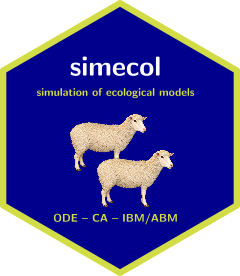

# R package "simecol" (Simulation in Ecology) 


## Overview

**simecol** is a lightweight [R](https://www.r-project.org) package that uses an object-oriented paradigm to implement dynamic simulation models.
It provides students and researchers with an interactive environment to build, distribute, simulate, and document both basic and advanced ecological models—without having to write long simulation programs from scratch.

A prototype-based object-oriented approach offers a consistent yet flexible and extensible framework across diverse model types, including:

- ordinary differential equation (ODE) models,
- non-spatial individual-based models,
- grid-oriented individual-based models,
- particle diffusion and random-walk models, and more.

A simulation model is represented as a **simecol** object (**simObj**) containing the following core slots:

- **main**: the primary model equations, rules, or arbitrary program code,
- **init**: initial state variables,
- **parms**: model parameters,
- **times**: the simulation time span and time steps,
- **equations** *(optional)*: a list of sub-models or nested sub-equations,
- **inputs** *(optional)*: external forcing or input data, and
- **observer** *(optional)*: a user-defined function for monitoring, logging, or visualizing states during simulation.

Another key design principle from the prototype paradigm is **cloning**, which makes it straightforward to create and organize multiple simulation scenarios consistently.

## Download

### Prerequisites

* simecol is based on [R](https://www.r-project.org), a freely available system for statistical computation and graphics. Current versions are tested with [R](https://www.r-project.org) version 3.0 or above.
* simecol depends on the [deSolve](https://cran.r-project.org/package=deSolve) package for numerical integration.
* Operating systems: All operating systems on which R can be installed: Linux and other Unixes, Windows, Mac

### Installation

The packages can be installed directly from the internet within [R](https://www.r-project.org) or [Rstudio](https://www.rstudio.com/) via the menu or the R command line:

**Stable Version**


``` r
install.packages("simecol")
```

**Development version**


``` r
library("devtools")
install_github("https://github.com/tpetzoldt/simecol")
```

## Examples

### Lotka-Volterra


``` r
library("simecol")
data(lv, package="simecol")
plot(sim(lv))
```

### Conway's Game of Life


``` r
library("simecol")
data(conway, package="simecol")
plot(sim(conway))
m <- matrix(0, 40, 40)
m[5:35,19:21] <-1
init(conway) <- m
sim(conway, animate=TRUE, delay=100, col=c("white", "green"), axes=FALSE)
```


### Template

The following example shows a template of the model structure:


``` r
library("simecol")
conway <- new("gridModel",
    main = function(time, init, parms) {
        x   <- init
        srv <- parms$srv
        gen <- parms$gen
        n   <- nrow(x)
        m   <- ncol(x)
        nb  <- eightneighbours(x)
        ## survival rule
        xsrv <- ifelse(x > 0 & (nb %in% srv), 1, 0)
        ## generation rule
        xgen <- ifelse(x == 0 & (nb %in% gen), 1, 0)
        x    <- as.numeric((xgen + xsrv)>0)
        dim(x) <- c(n,m)
    x
    },
    parms = list(srv=c(2, 3), gen=3),
    times = c(from=1, to=10, by=1),
    init = matrix(round(runif(40*40)), nrow=40, ncol=40),
    solver = "iteration"
)

plot(sim(conway))
```


### Publications

* Petzoldt, T. and K. Rinke (2007). simecol: An Object-Oriented Framework for Ecological Modeling in R. Journal of Statistical Software, 22(9), 1--31. [pdf](http://www.jstatsoft.org/v22/i09)
* Petzoldt, T. (2003). R as a Simulation Platform in Ecological Modelling. R-News 3(3), 8--16. [pdf](http://cran.r-project.org/doc/Rnews/Rnews_2003-3.pdf)
* Petzoldt, T., Rinke, K. and Kates, L. (2006) Population ecology modelling with R. A Comparison of Object Oriented Approaches. The R User Conference 2006, Vienna, 2006-06-15 to 2006-06-17 [slides](https://www.r-project.org/conferences/useR-2006/Slides/PetzoldtEtAl.pdf)
* Petzoldt, T. (2008) Objects, Clones and Collections. Dynamic (Ecological) Models and Scenarios with simecol. The R User Conference 2008, Dortmund, 2008-08-12 -- 2008-08-14. [slides](https://www.r-project.org/conferences/useR-2008/slides/Petzoldt.pdf)

### License

**simecol**, like R, is free open source software licensed under the [GNU Public License](https://www.gnu.org/licenses/#GPL) (GPL 2.0 or above). The software is provided as is and comes WITHOUT WARRANTY.

### Support

Please send your questions to the [R-SiG-Dynamic-Models](https://stat.ethz.ch/mailman/listinfo/r-sig-dynamic-models) mailing list.


2026-11-22

