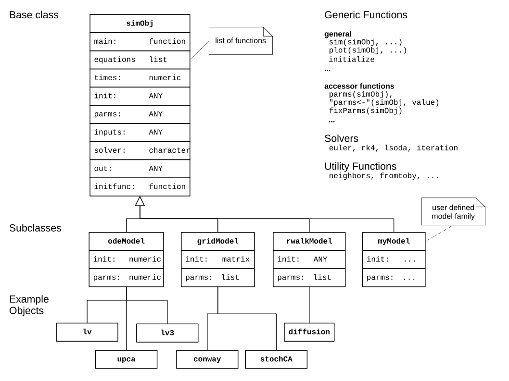
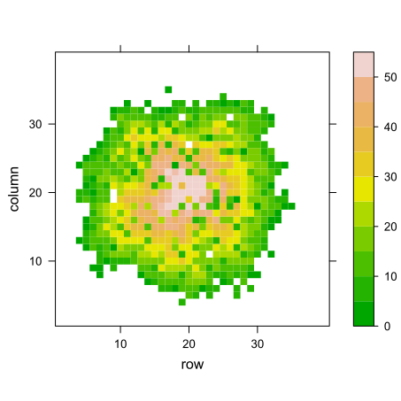
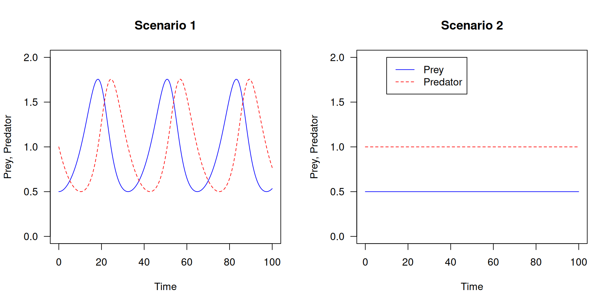
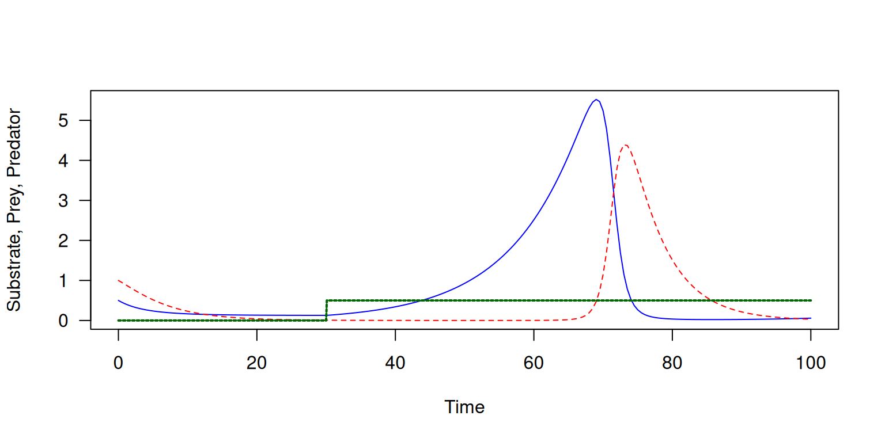
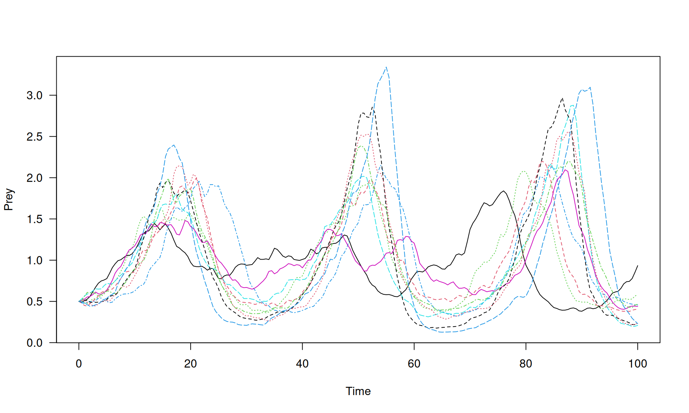
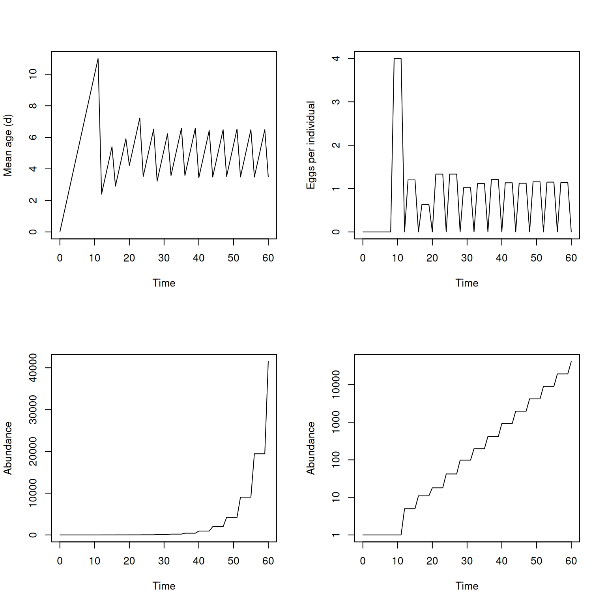
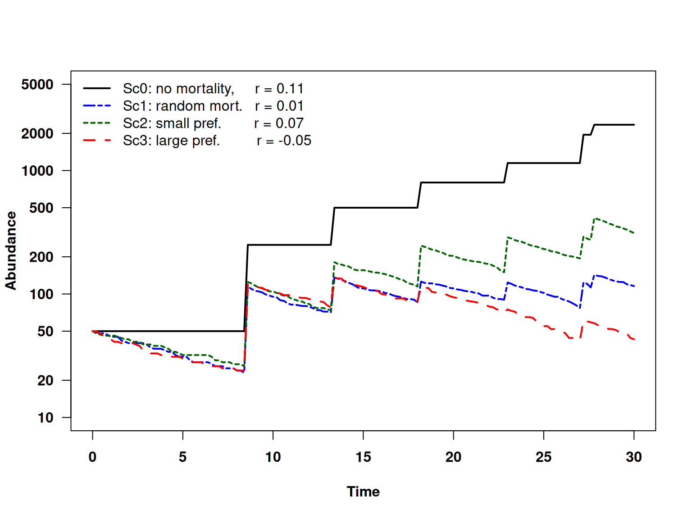

# 1. simecol: An Object-Oriented Framework for Ecological Modeling in R (JSS Paper)

**Abstract**

The **simecol** package provides an open structure to implement,
simulate and share ecological models. A generalized object-oriented
architecture improves readability and potential code re-use of models
and makes **simecol**-models freely extendable and simple to use. The
**simecol** package was implemented in the S4 class system of the
programming language R. Reference applications, e.g., predator-prey
models or grid models are provided which can be used as a starting point
for own developments. Compact example applications and the complete code
of an individual-based model of the water flea *Daphnia* document the
efficient usage of **simecol** for various purposes in ecological
modeling, e.g., scenario analysis, stochastic simulations and
individual-based population dynamics. Ecologists are encouraged to
exploit the abilities of **simecol** to structure their work and to use
R and object-oriented programming as a suitable medium for the
distribution and sharing of ecological modeling code.

> **Citation**
>
> A previous version of this document has been published as Petzoldt and
> Rinke ([2007](#ref-Petzoldt2007)) in the *Journal of Statistical
> Software*, <https://www.jstatsoft.org/v22/i09>. Please refer to the
> original publication when citing this work.

## 1 Introduction

The R system with the underlying S programming language is well suited
for the development, implementation and analysis of dynamic models. It
is, in addition to data analysis, increasingly used for model
simulations in many disciplines like pharmacology ([Tornø et al.
2004](#ref-Torno2004a)), psychology ([Maas et al. 2006](#ref-Maas2006)),
microbiology ([Jensen et al. 2006](#ref-Jensen2006)), epidemiology
([Hartley et al. 2006](#ref-Hartley2006)), ecology ([Fussmann et al.
2003](#ref-Fussmann2003); [Rinke and Vijverberg 2005](#ref-Rinke2005);
[Levey et al. 2005](#ref-Levey2005)) or econometrics ([Cribari-Neto and
Zarkos 1999](#ref-Cribari-Neto1999); [Zeileis et al.
2005](#ref-Zeileis2005)). Existing applications already cover a range
from small conceptual process and teaching models up to coupled
hydrodynamic-ecological models ([Rolinski et al.
2005](#ref-Rolinski2005)). Small models can be implemented easily in
pure R ([Petzoldt 2003](#ref-Petzoldt2003a)) or by means of the
XML-based Systems Biology Markup Language SBML and the corresponding
Bioconductor package ([Radivoyevitch 2004](#ref-Radivoyevitch2004)). For
more complex or computation-intensive simulations, R is primarily used
as an environment for data management, simulation control and data
analysis, while the model core may be implemented in other languages
like C/C++, FORTRAN or Java.

This works perfectly at the extremes, but problems appear with
medium-sized models. While larger modeling projects usually start with
an extensive planning and design phase carried out by experienced
people, small models can be implemented ad hoc without problems in R
from scratch or by modification of online help examples. On the other
hand, medium-sized applications often start by extension of small
examples up to ever-increasing size and complexity. An adequate design
period is often skipped and at the end of a modeling project no time
remains for re-design or appropriate documentation. The resulting
programs are necessarily ill-structured in most cases or at least
exhibit a very special, proprietary design.

The situation is even worse in ecological modeling, because this
discipline is broad, modeling strategies vary substantially and
ecological modelers are very creative. Different families of models
(e.g., statistical, differential equations, discrete event,
individual-based, spatially explicit) are applied alone or in mixtures
to different ecological systems (terrestrial, limnetic, marine) and
scales (individuals, laboratory systems, lakes/rivers/forests, oceans,
biosphere). Not enough that there is a Babel of programming languages
and simulation systems, there is also a Babel of approaches. There are
often cases where it seems to be necessary to understand the whole
source code when one tries to modify only one single parameter value or
to introduce a new equation and it is not seldom easier to re-write code
from scratch than to reuse an existing one.

We aim to propose a possible way out of the dilemma: an open structure
to implement and simulate ecological models. The R package **simecol**
is provided to demonstrate the feasibility of this approach including a
starter set of examples and utility functions to work with such models.

After giving a description of the design goals and the specification of
the `simObj` class in [Section 2](#sec-goals) and
[Section 3](#sec-approach), we demonstrate basic use of the package in
[Section 4](#sec-examples). The different mechanisms available to
implement and simulate `simObj` models are explained in
[Section 5](#sec-implementation). A complete individual-based model is
given in [Section 6](#sec-ownmodels) to elucidate how to use and extend
**simecol** in the modeling process. Finally, we discuss perspectives of
R and **simecol** in ecological modeling as well as relations to other
packages ([Section 7](#sec-discussion)).

## 2 Design goals

Our first goal is to provide a generalized architecture for the
implementation of ecological models. Such a unified style, which can be
considered as a template or prototype of model implementations, provides
manifold advantages for a scientific community. The structured
architecture will increase readability of the code by separating model
equations from other code elements, e.g., for numerical techniques. This
will enable ecological modelers to use R as a communication medium and
allows distributing model source code together with its documentation,
e.g., as an executable part of the “standard protocol for describing
individual-based and agent-based models” suggested by Grimm et al.
([2006](#ref-Grimm2006)).

We want to stress that we do not intend to establish yet another
simulation system. Complete simulation systems are numerous and
well-established for specified applications, e.g., STELLA[^1], Berkeley
Madonna[^2], VENSIM[^3], EcoBeaker[^4] or the GNU open source system
ECOBAS ([Benz et al. 2001](#ref-Benz2001a)). A comprehensive overview of
software used in ecological modeling is given elsewhere, e.g., at
<https://www.systemdynamics.org/> or Chapter 8 of Grimm and Railsback
([2005](#ref-Grimm2005)). These simulation systems can be extremely
effective for the specific class of applications they are intended for,
but they often lack the full power and flexibility of a programming
language. In such cases, model frameworks or simulation libraries are
commonly used to support one specific model family, e.g., Pascal
templates for ordinary differential and delay-differential equations
([Gurney and Nisbet 1998](#ref-Gurney1998)), an object-oriented C++
framework like OSIRIS ([Mooij and Boersma 1996](#ref-Mooij1996)) for
individual-based models or the Objective-C framework SWARM[^5] for
agent-based simulations.

An alternative approach is the use of high-level programming
environments and matrix-oriented languages like MATLAB[^6] or R ([R Core
Team 2026](#ref-Rcore2026)). Such languages allow a more interactive
development cycle compared to compiled languages, and outweigh their
performance handicap by efficient algorithms and compiled libraries for
numerics and data management. Both openness and interactivity have made
the R system a universal scripting interface for the free combination of
a large diversity of applications in statistics and scientific
computing.

The second design goal is to be as open as possible and to take
advantage of the open philosophy of R. Users should be allowed to employ
the full power of R’s graphical, statistical and data management
functions and to use arbitrary code written in R or compiled languages.
The complete code of **simecol**-models should be published under a
license that minimizes dependence on others and guarantees unrestricted
use in science and education, including the possibility to be modified
by others. Within this context, **simecol** is intended to provide a
framework on the meta-level identifying structural components of
ecological simulation models.

Our third design goal is ease of use and simplicity. One of the main
characteristics of programming languages like S and R is that users
become programmers ([Chambers 2000](#ref-Chambers2000)). Unfortunately,
ecologists are commonly not well-trained in programming, which often
hampers their application of models. Therefore, we aim to provide a
software layer that bridges this gap and helps ecologists to work with
models. In consequence, this means for **simecol** that simplicity of
implementation is more important than efficiency. The system should
support a broad level of user experience—in our case ecological models
covering the whole range from teaching models to research applications.

From the perspective of a first-time user it should be possible to run
simulations without knowing too much about R and implementation details.
A simulation of an ecological model should be as easy as fitting a
linear model in R (see example in [Section 3.3.1](#sec-simulation)). A
number of memorable “commands”, i.e., a few essential but not
overwhelmingly extensive generics for simulation, printing, plotting and
data access, and utility functions accompany this package. Both the
functions and also the simulation models should have meaningful defaults
to enable new users to get almost immediate success and to enable
experienced developers to structure their applications and to avoid
unnecessary copy and paste ([Mächler 2004](#ref-Maechler2004)).

## 3 Approach

The approach follows directly from the design goals to provide (i) a
standardized structure, (ii) open and reusable code and (iii) ease of
use of “the model”. It is almost self-evident to apply an
object-oriented design, consisting of:

1.  A general and extensible class description suitable for ecological
    simulation models that allows subclasses for different model
    families and multiple instances (objects of class `simObj`) which
    can be used simultaneously without interference.
2.  Generic functions which work on objects of these classes and behave
    differently depending on the model family they work with.

All equations, constants and data needed for one particular simulation
should be included in the model object, with the exception of general
and widely needed functions, e.g., numerical algorithms. In the
following sections we first analyze what is generally needed and then
describe the particular approach.

### 3.1 State space approach

Most ecological models can be formulated by means of a state space
representation, known from statistics and control theory
([Figure 1](#fig-statespace)). This applies to dynamic (discrete resp.
continuous) systems as well as to static, time-independent systems when
postulating that the latter case is a subset. A general description that
is valid for both linear and nonlinear systems can be given as:

``` math
\begin{aligned} \mathbf{\dot{x}}(t) &= \mathbf{f}(t, \mathbf{x}(t), \mathbf{u}(t), \mathbf{p}) \\ \mathbf{y}(t)       &= \mathbf{g}(t, \mathbf{x}(t), \mathbf{u}(t), \mathbf{p}) \end{aligned}
```

where $`\mathbf{x}`$ is the state of the system and $`\dot{\mathbf{x}}`$
its first derivative, $`t`$ the time, $`\mathbf{u}(t)`$ is the input
vector (or vector of boundary conditions), and $`\mathbf{y}`$ is the
output vector. The functions $`\mathbf{f}`$ and $`\mathbf{g}`$ are the
state transition function and the observation function, respectively,
which rely on a vector $`\mathbf{p}`$ of constant parameters.

A simulation of a dynamic system is obtained by applying a suitable
numerical algorithm to the function $`\mathbf{f}`$. This algorithm can
be a simple iteration or, when $`\mathbf{f}`$ is a system of ordinary
differential equations, an appropriate ODE solver or a function giving
an analytical solution.

Compared to the usual statistical models in R, ecological models are
more diverse in their structure and exhibit tight relationships between
procedural code (methods, equations) and data. Non-trivial ecological
models are based on more or less modular building blocks (submodels),
which are either base equations or complex models themselves.


Figure 1: State space diagram of a dynamic system ($`\mathbf{x}(t)`$:
state vector of the system, $`\mathbf{x}(t_0)`$ initial state,
$`\mathbf{\dot{x}}`$: first derivative of the state vector,
$`\mathbf{u}`$: input matrix, $`\mathbf{y}(t)`$: model output,
$`\mathbf{f}`$ state transition function, $`\mathbf{g}`$ observation
function, $`\mathbf{p}`$ constant parameters of $`\mathbf{f}`$ and
$`\mathbf{g}`$), figure redrawn after Ludyk ([1995](#ref-Ludyk1995)),
see also Bossel ([1992](#ref-Bossel1992)) and Wolkenhauer et al.
([2005](#ref-Wolkenhauer2005)).



Figure 2: Class diagram of `simObj` and related classes. The subclasses
and example model objects are provided as reference for user-defined and
future extensions.

### 3.2 The `simObj` specification

In essence, what do we need to implement a not too narrow class of
ecological models? We need self-contained objects derived from classes
with suitable properties and methods (data slots and function slots)
resulting from the state space description: state variables, model
equations and algorithms, model parameters (constants), input values,
time steps, the name of an appropriate numerical algorithm (solver), and
an optional set of possibly nested sub-models (sub-equations). These
parts are implemented as slots of the `simObj` class from which
subclasses for different model families can inherit
([Figure 2](#fig-classes)).

A small set of supporting functions is provided to work with these
objects, namely:

- Generic functions for simulation, printing, plotting, slot
  manipulation (accessor functions) and object creation (`initialize`
  functions).
- Utility functions, e.g., neighborhood relations for cellular automata.

### 3.3 Generic functions

In the S4 class model of the S language, methods are based on generic
functions. They specify the behavior of a particular function, depending
on the class of the function arguments ([Chambers
2001](#ref-Chambers2001)). All generic functions in **simecol** are
defined as default methods for the class `simObj` and specific methods
exist if necessary for subclasses. If new subclasses are defined for
additional model families by the user it may be necessary to create new
methods that work with these user-defined data types and provide the
required functionality.

#### 3.3.1 Simulation

The core function to work with `simObj`ects is the generic function
`sim(simObj, ...)`, which, for dynamic systems, simulates an initial
value problem using the initial state, boundary conditions, equations
and parameters stored in one particular `simObj` instance by calling the
numerical algorithm referred to by its name in the `solver` slot of
`simObj`. Common for all versions of `sim` is the pass-back modification
behavior, i.e., a modified version of the original `simObj` is returned
with a newly added or updated slot `out` holding the simulation results:

``` r

library("simecol")
data(lv, package = "simecol")
lv <- sim(lv)
plot(lv)
o1 <- out(lv)
```

The functionality of `sim` can vary for different subclasses of
`simObj`, e.g., `odeModel`, `gridModel`, `rwalkModel`. This behavior
results mainly from a different data structure of the state variables
and the set of numerical algorithms that are adequate for a given family
of ecological models. Whereas ODE models have a vector for state and a
data frame for outputs, grid models may have a grid matrix for state and
a list of grids (one grid per time step) as output, and finally, random
walk models may have a list for the initial state of the particles and a
list of lists for the output.

The returned `simObj` can be printed and plotted directly with
appropriate functions, the simulation results can be extracted with
`out` or the resulting `simObj` can be used in another simulation with
modified data or functionality.

#### 3.3.2 Accessor functions

Similar to the `out` function, other accessor functions are available
for all slots with (in contrast to `out`) not only read but also write
access. These functions are used similarly to the base function `names`
and work with the appropriate data structures; see help files for
details. The functions allow changing either the whole content of the
respective slot or single elements, e.g., parameter values, time steps
or equations. For example, the following will change only the parameter
value of `k1`:

``` r

parms(lv)
```

     k1  k2  k3
    0.2 0.2 0.2 

``` r

parms(lv)["k1"] <- 0.4
```

An entirely new parameter is added to the parameter vector via:

``` r

parms(lv)["a"] <- 1
parms(lv)
```

     k1  k2  k3   a
    0.4 0.2 0.2 1.0 

Elements can be deleted when a modified version of the parameter vector
is assigned:

``` r

parms(lv) <- parms(lv)[-4]
parms(lv)
```

     k1  k2  k3
    0.4 0.2 0.2 

The behavior is analogous for all other slots with the exception of
`out`, given that the correct data type for the respective slot (vector,
list or matrix) is used.

In addition to the command line accessor functions, graphical Tcl/Tk
versions exist (`editParms`, `editTimes`, `editInit`)[^7]; however, more
complex data types cannot be handled yet by these functions.

#### 3.3.3 Numerical algorithms

In order to simulate ecological models of various types, the appropriate
numerical algorithms can be plugged into the `sim` function either by
using an existing function, e.g., from this package, by imported solvers
of package **deSolve** or by user-defined algorithms.

The algorithm used for one particular `simObj` is stored as a character
string in the `solver` slot of the object. User-defined algorithms have
to provide interfaces (parameter line, output structure) and
functionality (see below) that fit into the respective object
specification and are compatible with the data structures of the
particular class.

### 3.4 Utility functions

A few utility functions are provided for overcoming frequently occurring
problems. However, it is not planned to overload **simecol** with
numerous utilities as most of them are application-specific. Additional
supporting functions should be written in the user workspace when they
are needed or may be included in optional packages.

#### 3.4.1 Interpolation

Dynamic systems often require interpolation of input data. This is
particularly important for ODE solvers with automatic step size
adjustment and there are cases where excessive interpolation outweighs
the advantages of automatic step size determination.

The performance of linear approximation is crucial and we found that the
performance of the respective functions from the **base** package can be
increased if `approxfun` is used instead of `approx`, if matrices are
used instead of data frames and if the number of data (nodes) in the
inputs is limited to the essential minimum. In addition to this, two
special versions `approxTime` and `approxTime1` provided by **simecol**
may be useful; see the help file for details.

#### 3.4.2 Neighborhood functions

The computation of neighborhood is time-critical for cellular automata.
Two C++ functions, `eightneighbors` (direct neighbors) and `neighbors`
(generalized neighborhood with arbitrary weight matrices), are provided
for rectangular grids. The implementation of these functions is
straightforward and may serve as a starting point for even more
efficient solutions or other grid types, for example hexagonal or 3D
grids.

Neighborhood functions can also be used for spatially explicit models.
Models of this family commonly include both an explicit spatial
representation of organisms (in most cases with real-valued locations)
and a grid-based representation of environmental factors ([Dunning et
al. 1995](#ref-Dunning1995); [Grimm and Railsback
2005](#ref-Grimm2005)).

### 3.5 Example models

A set of small ecological models is supplied with the package. These
models are intended as a starting point for testing the package and for
own developments. The models are provided in two versions, as binary
objects in the `data` directory and in full source code in the directory
`examples`. The number of example models is intentionally limited and
will grow only moderately in the future. In addition to this, ecological
models which follow the `simObj` specification are well suited to be
published and shared between scientists either as single code objects or
in domain-specific packages.

``` r

CA <- new("gridModel",
  main = function(time, init, parms) {
    z     <- init
    nb    <- eightneighbors(z)
    pgen  <- 1 - (1 - parms$pbirth)^nb
    zgen  <- ifelse(z == 0 &
               runif(z) < pgen, 1, 0)
    zsurv <- ifelse(z >= 1 &
               runif(z) < (1 - parms$pdeath),
               z + 1, 0)
    zgen + zsurv
  },
  parms  = list(pbirth = 0.02, pdeath = 0.01),
  times  = c(from = 1, to = 50, by = 1),
  init   = matrix(0, nrow = 40, ncol = 40),
  solver = "iteration"
)
init(CA) <- 1
```



Figure 3: Stochastic cellular automaton, source code (left) and after 50
iterations (right).

## 4 Two introductory examples

### 4.1 Cellular automaton

At the first level of experience, users can simply explore example
models supplied with the package or provided by other users without
caring too much about implementation details. They can be loaded with
`source` from hard disk or the Internet, for example the stochastic
cellular automaton shown in [Figure 3](#fig-stochCA):

``` r

# library("simecol")
data(CA, package = "simecol")
CA <- sim(CA)
plot(CA)
```

Note that the `sim` function uses pass-back modification, i.e., the
result is the complete `simObj` with the model outputs inserted. The
advantage is that the resulting `simObj` is consistent, i.e., the model
output corresponds to the equations, parameters and other settings of
the `simObj`. Now, the settings may be inspected and changed, e.g., the
number of time steps:

``` r

times(CA)
times(CA) <- c(to = 100)
CA <- sim(CA)
plot(CA)
```

### 4.2 Predator-prey model

A second built-in demonstration example of **simecol** is the elementary
Lotka-Volterra predator-prey model, which can be given by two ordinary
differential equations:

``` math
\begin{aligned} \frac{dX_1}{dt} &= k_1 X_1 - k_2 X_1 X_2   \\ \frac{dX_2}{dt} &= - k_3 X_2 + k_2 X_1 X_2 \end{aligned}
```
{#eq-lv}

In order to reproduce a schoolbook example, two scenarios may be created
by modifying two copies (clones) of `lv`:

``` r

# library("simecol")
data(lv, package = "simecol")
lv1 <- lv2 <- lv
```

We now inspect default settings of initial values and parameters, modify
them as required for `lv2` and simulate both scenarios:

``` r

init(lv1)
```

        prey predator
         0.5      1.0 

``` r

parms(lv1)
```

     k1  k2  k3
    0.2 0.2 0.2 

``` r

parms(lv2)["k3"] <- 0.1
lv1 <- sim(lv1)
lv2 <- sim(lv2)
```

The outputs of `lv1` and `lv2` can be compared visually using the
plotting method of the `odeModel` class (`plot(lv1)`) or with regular
plotting functions after extracting the outputs ([Figure 4](#fig-lv12)).
It is quite obvious that scenario 1 produces stable cycles and that
scenario 2 is at equilibrium for the given initial values and
parametrization, because of:

``` math
\begin{aligned} \frac{dX_1}{dt} &= 0.2 \cdot 0.5 - 0.2 \cdot 0.5 \cdot 1 = 0 \\ \frac{dX_2}{dt} &= -0.1 \cdot 1  + 0.2 \cdot 0.5 \cdot 1 = 0 \end{aligned}
```



Figure 4: Two scenarios of a basic Lotka-Volterra model. Scenario 1
(left) shows stable cycles, Scenario 2 (right) is at equilibrium.

It is a particular advantage of R that the complete set of statistical
functions is immediately available, e.g., to inspect summary statistics
like the range:

``` r

sapply(o1[c("predator", "prey")], range)
```

          predator     prey
    [1,] 0.5001358 0.500000
    [2,] 1.7563205 1.755704

``` r

sapply(o2[c("predator", "prey")], range)
```

         predator prey
    [1,]        1  0.5
    [2,]        1  0.5

The identity of the lower and upper limits for scenario 2 confirms the
equilibrium state. Moreover, the period length of the cycles of scenario
1 can be analyzed by means of spectral analysis:

``` r

tlv <- times(lv1)
ots <- ts(o1[c("predator", "prey")], start = tlv["from"],
          end = tlv["to"], deltat = tlv["by"])
sp  <- spectrum(ots, spans = c(3, 3), log = "no", plot = FALSE)
1 / sp$freq[sp$spec[, 1] == max(sp$spec[, 1])]
```

    [1] 36

which yields an estimated period length of approximately 36 time units.

``` r

lv <- new("odeModel",
  main = function(time, init, parms, ...) {
    x <- init
    p <- parms
    dx1 <-   p["k1"] * x[1] - p["k2"] * x[1] * x[2]
    dx2 <- - p["k3"] * x[2] + p["k2"] * x[1] * x[2]
    list(c(dx1, dx2))
  },
  parms  = c(k1 = 0.2, k2 = 0.2, k3 = 0.2),
  times  = c(from = 0, to = 100, by = 0.5),
  init   = c(prey = 0.5, predator = 1),
  solver = "rk4"
)
```

Listing 1: Implementation example of the elementary Lotka-Volterra
model.

``` r

upca <- new("odeModel",
  main = function(time, init, parms) {
    with(as.list(c(init, parms)), {
      du <-  a * u           - alpha1 * f(u, v, k1)
      dv <- -b * v           + alpha1 * f(u, v, k1) - alpha2 * f(v, w, k2)
      dw <- -c * (w - wstar) + alpha2 * f(v, w, k2)
      list(c(du, dv, dw))
    })
  },
  equations = list(
    f1 = function(x, y, k) { x * y },                     # Lotka-Volterra
    f2 = function(x, y, k) { f1(x, y, k) / (1 + k * x) }  # Holling II
  ),
  times  = c(from = 0, to = 100, by = 0.1),
  parms  = c(a = 1, b = 1, c = 10, alpha1 = 0.2, alpha2 = 1,
             k1 = 0.05, k2 = 0, wstar = 0.006),
  init   = c(u = 10, v = 5, w = 0.1),
  solver = "lsoda"
)

equations(upca)$f <- equations(upca)$f1
```

Listing 2: Uniform Period Chaotic Amplitude Model after Blasius et al.
([1999](#ref-Blasius1999)). Note that function `f1` is nested within
`f2`.

## 5 Implementation of `simecol` models

### 5.1 Lotka-Volterra model

The implementation of the Lotka-Volterra equations is straightforward
and results in a compact S4 object ([Listing 1](#lst-lvmodel)). The two
equations (**?@eq-lv**) can easily be put into the `main` function and
there is no need for sub-equations. The code can be made even simpler
without the two assignments at the beginning of `main`, but with respect
to more structured models we found it generally advantageous to keep the
default values of the names in the parameter line and on the other hand
to use common symbols in the equations.

### 5.2 Models with nested subequations

For large models with numerous equations or for models with alternative
(i.e., exchangeable) submodels it may be preferable to use a separate
structure. Although **simecol** principally allows implementing
subroutines as local functions of the `main` slot or even directly in
the user workspace, such a strategy would not be in line with our design
goals. Instead, the `equations` slot of the `simObj` class definition
provides the structure where relevant submodels and model equations are
stored. Consistent usage of the `equations` slot helps to increase the
readability of the `main` function, leads to more structured code and
complies with the object-oriented paradigm. Moreover, the `equations`
slot can be used to store alternative submodels; see
[Listing 2](#lst-upca) for a small example.

In this example, two versions of the functional response can be enabled
alternatively by assigning one of `f1` or `f2` to `f` via `equations`
(last line of [Listing 2](#lst-upca)) and with the same mechanism it is
possible to introduce further functional response curves.

The example shows also several techniques for scoping: (i) the parameter
vector is “unpacked” using `with`[^8], (ii) parameters are explicitly
passed to subequations and (iii) slot functions of `equations` can be
used without explicit pass-through, a functionality that is provided by
the `solver` functions. The result is that all elements of the
`equations` slot are visible within `main` and within all other
functions of `equations`.

### 5.3 Input data

The simulation models presented so far are autonomous, i.e., they have
no external forcing data (matrix $`\mathbf{u}`$ in
[Figure 1](#fig-statespace)). Such time-dependent data, e.g., food
availability or meteorological conditions, which are required in many
practical cases can be provided in the `inputs` slot. In order to give a
minimal example we may create a new `odeModel` by modifying a clone
`lv_ef` of the elementary predator-prey model. To enable external
forcing a modified version of the `main` slot is introduced, that
simulates substrate ($`S`$) dependent growth of the prey population:

``` r

lv_ef <- lv

main(lv_ef) <- function(time, init, parms, ...) {
  x <- init
  p <- parms
  S <- approxTime1(inputs, time, rule = 2)["s.in"]
  dx1 <-   S * p["k1"] * x[1] - p["k2"] * x[1] * x[2]
  dx2 <- - p["k3"] * x[2] + p["k2"] * x[1] * x[2]
  list(c(dx1, dx2))
}
```

For linear interpolation the utility function `approxTime1` is used here
to read the input at correct time steps from the input matrix, which can
be given as:

``` r

inputs(lv_ef) <- as.matrix(data.frame(
  time = c(0, 30, 30.1, 100),
  s.in = c(0,  0,  0.5, 0.5)
))
```

Note that inputs are converted into a matrix for performance reasons
because otherwise repeated conversions would be performed by
`approxTime1`, or similarly by `approx`, which would be time-consuming,
especially for larger input data sets.

The resulting model can then be easily simulated and plotted and results
in [Figure 5](#fig-lv_eff3):

``` r

o <- out(sim(lv_ef))
matplot(o$time, o[2:3], xlab = "Time",
  ylab = "Substrate, Prey, Predator", type = "l",
  lty = c("solid", "dashed"), col = c("blue", "red"), las = 1)
inp <- as.data.frame(inputs(lv_ef))
lines(inp$time, inp$s.in, col = "darkgreen", lwd = 2, lty = "11")
```



Figure 5: Externally forced predator-prey model (prey: blue, solid;
predator: red, dashed) with resource (green dotted line).

``` r

lv_efr <- lv_ef
tt     <- fromtoby(times(lv_efr))
o      <- matrix(0, nrow = length(tt), ncol = 10)
initfunc(lv_efr) <- function(obj) {
  tt <- fromtoby(times(obj))
  inputs(obj) <- as.matrix(data.frame(
    time = tt,
    s.in = pmax(rnorm(tt, mean = 1, sd = 0.5), 0)
  ))
  obj
}
for (i in 1:10) {
  lv_efr <- initialize(lv_efr)
  lv_efr <- sim(lv_efr)
  o[, i] <- out(lv_efr)$prey
}
matplot(tt, o, xlab = "Time", ylab = "Prey", las = 1, type = "l")
```



\(a\) Ten stochastic realizations of the model.

Listing 3: Predator-prey simulation with stochastic input variables. The
example is derived from the externally forced object `lv_ef`. An
initialization function `initfunc` is provided which is called by
`initialize` and returns a re-initialized `obj` with a new random sample
of input values. The utility function `fromtoby` is used to expand the
time vector from its compact form `c(from=, to=, by=)` into a sequence.

### 5.4 Initializing

Sometimes, it may be required to perform computations while initializing
a `simObj`. This may be either required to ensure consistency between
different slots (e.g., parameters, inputs and initial values), to
perform error checking or to create non-deterministic variants.
Initializing methods, which exist in R as class methods of the generic
`initialize`, are called either explicitly or implicitly during object
creation. The syntax allows, in principle, two different modes of use.
One can either provide all slots of the object in creation as named
arguments to `new` or one can provide an existing `simObj` as the first
unnamed argument to `initialize` in order to get a re-initialized
clone[^9].

In the case of `simObj` this mechanism is extended by an optionally
existing function slot `initfunc`, which is executed during the object
creation process. Object creation is then as follows: in the first step
an incomplete object is created internally via `new` according to the
slots given and in the second step this object in creation is passed to
the `obj` argument of `initfunc` which performs the final steps and
returns the complete object.

It would, of course, also be possible to create a provisional object
first and to modify it afterwards with accessor functions, but
`initfunc` provides a more efficient solution and helps to ensure
consistency, e.g., between parameters and inputs, between `times` and
`inputs` or between different state variables.

In the example shown in [Listing 3](#lst-lv_efr) new instances with
different stochastic realizations of the input variables are created and
simulated (see [Figure 3 (a)](#fig-lvefr)). Note that `initfunc` is
called automatically every time new instances are created via `new` or
`initialize`.

## 6 Creating own models

### 6.1 The modeling cycle

The modeling process is an iterative cycle of tasks (see [Grimm and
Railsback 2005](#ref-Grimm2005)). It begins with the formulation of (i)
questions and (ii) hypotheses, (iii) the translation of these questions
into a specific model structure, (iv) the implementation of the model in
the form of computer software, (v) the analysis, test and (in most
cases) revision of the model, and (vi) communication of the model and
its results to the scientific community. Another view is given by Fowler
and Scott ([1997](#ref-Fowler1997)), who with respect to software
modeling suggested distinguishing three different perspectives:

1.  Conceptional perspective
2.  Specification perspective
3.  Implementation perspective

These perspectives are complementary to the tasks defined by Grimm and
Railsback ([2005](#ref-Grimm2005)) when tasks (i)–(ii) are regarded as
conceptional and task (iii) as specification. In the following we
concentrate on task (iv) to explain by means of a real, but still simple
example, how a specified model can be implemented using R and the
**simecol** software.

### 6.2 Conceptional perspective: an individual-based model of *Daphnia*

The scientific purpose of the *Daphnia* model given here was the
analysis of demographic effects of *Daphnia* (water flea) populations.
Two main hypotheses were to be tested:

- Size-selective predation leads to an increased population mortality
  rate, compared to non-selective predation by fish ([Mehner et al.
  1998](#ref-Mehner1998)).
- In comparison to predictions from the conventional Lotka-Volterra
  approach, the inclusion of demographic effects results in a delayed
  but then unexpectedly rapid decline of abundance during periods of
  food limitation due to ageing effects ([Hülsmann and Voigt
  2002](#ref-Huelsmann2002)).

Due to a multiple number of important features, the genus *Daphnia*
(water flea) is an outstanding model organism in limnology, toxicology
and population ecology, so results derived on this example may be of
general interest to other areas as well.

The *Daphnia* model consists of three general parts:

1.  A semi-empirical model of temperature- and food-dependent somatic
    growth and egg production derived from laboratory experiments (TeFI
    = temperature-food-interaction model) according to Rinke and
    Petzoldt ([2003](#ref-Rinke2003)).
2.  An empirical function of egg development time after Bottrell et al.
    ([1976](#ref-Bottrell1976)).
3.  A non-spatial individual-based simulation of population dynamics.

Individual-based models (IBMs) are a popular technique in ecological
modeling ([DeAngelis and Gross 1992](#ref-DeAngelis1992a); [Grimm
1999](#ref-Grimm1999); [Grimm and Railsback 2005](#ref-Grimm2005)). It
is our aim to demonstrate how such models can be implemented with
**simecol**.

### 6.3 Model specification

The state of the system is defined as a sample of individuals, each
having four states: age, size, number of eggs and age of eggs.
Population development is dependent on two environmental variables: food
(phytoplankton, given in $`\mathrm{mg\,L^{-1}}`$ carbon) and temperature
(in °C). The model is simulated in fixed time steps (usually 0.1 day)
over a period of several days up to a few months. The time scales are
selected with respect to the egg development time, which is about 4.4
days at 15 °C ([Bottrell et al. 1976](#ref-Bottrell1976)).

The life cycle of *Daphnia* starts with the release of neonate
individuals of a given size ($`L_0`$) from the brood chamber of the
mother into the water. Somatic growth follows the von Bertalanffy growth
equation ([von Bertalanffy 1957](#ref-Bertalanffy1957)), depending on
several empirical parameters. As soon as an individual reaches a fixed
size at maturity (SAM), a clutch of eggs is produced (spawned), whereby
the clutch size (number of eggs) is controlled by food availability.
After a temperature-dependent egg development time, the individuals from
this clutch are released (hatched) and the cycle is started again
(parthenogenetic, i.e., asexual reproduction).

Mortality can be modeled with arbitrary deterministic or stochastic
mortality functions, e.g., size-dependent mortality due to fish
predation, but for the first simulation a deterministic fixed maximum
age is used. All equations and parameters are given in detail in Rinke
and Petzoldt ([2003](#ref-Rinke2003)) and although more elaborate
bioenergetic *Daphnia* models are available in the meantime ([Rinke and
Vijverberg 2005](#ref-Rinke2005); [Rinke et al. 2005](#ref-Rinke2005a)),
the relatively simple model given here should be sufficient for the
intended purpose.

### 6.4 Model implementation

#### 6.4.1 Definition of a user-defined subclass

A subclass for non-spatial individual-based models was not available in
past versions of **simecol**, but could be easily derived from `simObj`
as a class with appropriate data types, in particular with a
`data.frame` for the table of the individuals stored in `init`:

``` r

setClass("indbasedModel",
  representation(
    parms  = "list",
    init   = "data.frame"
  ),
  contains = "simObj"
)
```

Since **simecol** version 0.8-4, class `indbasedModel` is a built-in
class. The code snippet above is left in this document as an example of
how to derive user-defined subclasses.

#### 6.4.2 Implementation of the model equations

The implementation which is provided in [Listing 4](#lst-ibmdaphnia1)
and [Listing 5](#lst-ibmdaphnia2) starts with the selection of an
appropriate data structure for the state variables. A table of
individuals with four columns—age, size, number of eggs and age of eggs
(`eggage`)—is realized as a data frame with one row for each individual.
The data frame is initialized with an arbitrary number of start
individuals (e.g., one single juvenile animal in the `init` slot).

The `main` function simulates the life cycle of *Daphnia* and calls the
sub-equations `live`, `survive` and `hatch` which implement the
following processes:

- **`live`:** The age of all individuals and the egg-age for individuals
  with eggs is incremented by the actual time step `DELTAT`. Then, the
  empirical function `tefi` is called to estimate length and potential
  number of eggs as a function of age, food and temperature. The data
  frame of individuals is then updated and for all adult individuals
  (`size > SAM`) which currently have no eggs, the appropriate number of
  eggs is initialized.
- **`survive`:** The survival function returns the subset of surviving
  individuals. Note that it is particularly easy in R to implement
  survival with the `subset` function by simply applying a logical rule
  to the table of individuals and returning only those rows which match
  the condition.
- **`hatch`:** In a first step the actual egg age is compared with the
  egg development time. Then the total number of mature eggs is counted
  and a data frame (`newinds`) with an appropriate number of individuals
  is created (function `newdaphnia`). Population growth occurs by
  appending the data frame with newborns (`newinds`) to the data frame
  of the surviving (`inds`).

All functions of the life cycle receive the actual table of individuals
(`init`) as their first argument and return an updated table `inds`
which is then passed back to `init`.

The model is simulated by iteration over the time vector. Note that in
contrast to ODE models, the `main` function explicitly returns the new
state and not derivatives. To account for this, the `iteration`
algorithm is to be used here and not one of the ODE solvers like
`euler`, `rk4` or `lsoda`.

A number of constant parameters is needed by the empirical model (see
[Rinke and Petzoldt 2003](#ref-Rinke2003) for details), which are
represented as a list within the `parms` slot.

### 6.5 Model simulation

With the `ibm_daphnia` object derived from the `indbasedModel` class and
given as complete source code in [Listing 4](#lst-ibmdaphnia1) and
[Listing 5](#lst-ibmdaphnia2), it is now possible to perform a first
simulation:

``` r

solver(ibm_daphnia) <- "iteration"
ibm_daphnia <- sim(ibm_daphnia)
```

This already works with the `iteration` method provided by the package,
but the default behavior may not be optimal for the concrete subclass.

One disadvantage here is the fact that the default `iteration` algorithm
stores the complete state data structure (i.e., the complete data frame)
for each time step as a list in the `out` slot. This behavior is rather
memory-consuming for individual-based simulations with several hundred
or thousand individuals. Moreover, no adequate plotting method is
currently available for such a list of data frames and therefore the
default `plot(simObj)` method simply returns a warning message.

### 6.6 Class-specific functions and methods

Depending on the complexity of the model it may be necessary to supply
either an own solver function or a complete `sim` method. The difference
is that only one `sim` method is available for one particular class, but
several solver functions may be provided as alternatives for one class,
either as S4 methods with different names or as ordinary (non-generic)
functions.

In most cases it should be sufficient to write class-specific solvers,
but for complicated data structures or hybrid model architectures it may
be necessary to provide class-specific `sim` methods. In the case of the
individual-based *Daphnia* model, the solver should be of type
“iterator” but with additional functionality to reduce the amount of
data stored in `out`. To do this, `myiteration` given in
[Listing 6](#lst-mysolver) has a local function `observer`, which for
each time step returns one line of summary statistics for all
individuals. Additionally, it would also be possible to write data to
logfiles, to print selected data to screen or to display animated
graphics during simulation.

The argument naming of the solver functions is compatible with the ODE
solvers of the **deSolve** package with respect to the first four
arguments. Moreover, some essential functionality must be provided by
all solvers:

1.  Extraction of slots of the `simObj` (argument `y`) to local
    variables, expansion of `y@times` via `fromtoby`, `attach` and
    `detach` (or `addtoenv`) for the list of equations as given in the
    example.
2.  Iteration loop or any other appropriate numeric algorithm.
3.  Assignment of the special parameter `DELTAT` (optional, if needed by
    the model).
4.  Accumulation of essential simulation results to the outputs (`out`
    slot) and assignment of explanatory variable names, in this case
    done by `observer`.

Depending on the data structure, it is also possible to write a
class-specific plot function:

``` r

setMethod("plot", c("indbasedModel", "missing"), function(x, y, ...) {
  o <- out(x)
  par(mfrow = c(2, 2))
  plot(o$times, o$meanage,  type = "l", xlab = "Time", ylab = "Mean age (d)")
  plot(o$times, o$meaneggs, type = "l", xlab = "Time", ylab = "Eggs per individual")
  plot(o$times, o$number,   type = "l", xlab = "Time", ylab = "Abundance")
  plot(o$times, o$number,   type = "l", xlab = "Time", ylab = "Abundance", log = "y")
})
```

### 6.7 Model application

Now, the model can be simulated and used for the intended application,
e.g., hypothesis testing, parameter estimation or scenario analysis:

``` r

solver(ibm_daphnia) <- "myiteration"
ibm_daphnia <- sim(ibm_daphnia)
plot(ibm_daphnia)
```



Figure 6: Result of the `plot` method of the *Daphnia* model; top: mean
age of the population and number of eggs indicating synchronized
population development; bottom: exponential population growth in linear
resp. logarithmic scale.

It is beyond the scope of this paper to provide an overview of
simulation techniques or to answer domain-specific questions about
*Daphnia* population dynamics; however, the following example is
intended to give an impression of how **simecol** models can be used in
practice. The example deals with the effect of size-selective predation,
similar to the more extensive analysis of Mooij et al.
([1997](#ref-Mooij1997)). Four scenarios will be compared:

- **Sc0:** no mortality at all,
- **Sc1:** constant mortality (independent of body length),
- **Sc2:** small individuals preferred (typical for invertebrate
  predators like *Chaoborus*, phantom midge larvae),
- **Sc3:** large individuals preferred (typical for adult fish).

At the first step we create one clone of the `ibm_daphnia` object,
assign settings common to all scenarios and an initial sample
population:

``` r

Sc0                                   <- ibm_daphnia
times(Sc0)                            <- c(from = 0, to = 30, by = 0.2)
parms(Sc0)[c("temp", "food", "mort")] <- c(15, 0.4, 0.1)
init(Sc0) <- data.frame(age = rep(10, 50), size = rep(2.5, 50),
                        eggs = rep(5, 50), eggage = runif(50, 0, 4))
```

Then we replace the default `survive` function with a more general one
which depends on a user-specified mortality function `fmort`:

``` r

equations(Sc0)$survive <- function(inds, parms) {
  abundance <- nrow(inds)
  rnd       <- runif(abundance)
  mort      <- fmort(parms$mort, inds$size) * parms$DELTAT
  subset(inds, rnd > mort)
}
```

Copies of object `Sc0` are created and modified according to the
scenario specification. In the example below we have two functions with
constant mortality and two other functions where per capita mortality is
higher for the larger or smaller individuals, respectively:

``` r

Sc1 <- Sc2 <- Sc3 <- Sc0
equations(Sc0)$fmort <- function(mort, x) 0
equations(Sc1)$fmort <- function(mort, x) mort
equations(Sc2)$fmort <- function(mort, x) {
  mort * 2 * rank(-x) / (length(x) + 1)
}
equations(Sc3)$fmort <- function(mort, x) {
  mort * 2 * rank(x) / (length(x) + 1)
}
```

Finally, the scenarios can be simulated, either line by line as in
[Section 4.2](#sec-predprey) or listwise with `lapply`:

``` r

sc <- lapply(list(Sc0 = Sc0, Sc1 = Sc1, Sc2 = Sc2, Sc3 = Sc3), sim)
```

``` r

growthrate <- function(obj) {
  o <- subset(out(obj), times > 10)
  m <- lm(log(o$number) ~ o$times)
  as.vector(coef(m)[2])
}

abundplot <- function(ref, sc1, sc2, sc3) {
  par(las = 1)
  plot(out(ref)[c("times", "number")],
      type = "l", xlab = "Time", ylab = "Abundance",
      log = "y", ylim = c(10, 5000),
      main = "",
      font = 2, font.lab = 2, lwd = 2
  )
  lines(out(sc1)[c("times", "number")], col = "blue", lty = "6222", lwd = 2)
  lines(out(sc2)[c("times", "number")], col = "darkgreen", lty = "22", lwd = 2)
  lines(out(sc3)[c("times", "number")], col = "red", lty = "66", lwd = 2)
  legend("topleft",
    c(paste("Sc0: no mortality,     r =", round(growthrate(ref), 2), collapse = " "),
      paste("Sc1: random mort.   r =", round(growthrate(sc1), 2), collapse = " "),
      paste("Sc2: small pref.        r =", round(growthrate(sc2), 2), collapse = " "),
      paste("Sc3: large pref.         r =", round(growthrate(sc3), 2), collapse = " ")
    ),
    col = c("black", "blue", "darkgreen", "red"), lty = c("solid", "6222", "22", "66"),
    bty = "n", lwd = 2
  )
}
abundplot(sc$Sc0, sc$Sc1, sc$Sc2, sc$Sc3)
```



Figure 7: Time series of *Daphnia* abundance for different scenarios
with non-selective resp. size-selective mortality. Population growth
rates ($`r`$ in $`\mathrm{d^{-1}}`$) were approximated by log-linear
regression for all data points after an initial period of 10 days.

The result shows very clearly the influence of demography on population
growth ([Figure 7](#fig-daphnia2)). Given that the population growth
rate $`r`$ without any mortality (i.e., equal to the birth rate $`b`$)
is approximately 0.11 $`\mathrm{d}^{-1}`$ in `Sc0` and the mortality
rate $`d`$ is set to $`0.1\,\mathrm{d}^{-1}`$, it is plausible that the
population growth rate in `Sc1` is:

``` math
r = b - d \approx 0.01\,\mathrm{d}^{-1}
```

In the case of size-selective predation, demography has to be taken into
account in order to get realistic estimations of $`r`$. The simulation
shows an increased population loss in case of fish predation (`Sc3`,
$`r = -0.05`$) and a lower effect in case of *Chaoborus* (`Sc2`,
$`r = 0.07`$). Please see Mooij et al. ([1997](#ref-Mooij1997)) and
Mooij et al. ([2003](#ref-Mooij2003)) for details and how the results
may depend on fecundity of the prey, the shape of the selection function
and the dynamics of predator and prey.

## 7 Discussion

The main contribution of the **simecol** package is the proposal of a
generalized, declarative structure to describe ecological models. This
structure was inspired by the state space representation used in control
theory and is intended as a pragmatic solution to unify the upcoming
diversity of R implementations of ecological models. The object-oriented
`simObj` structure may be useful also in other areas and for other
models like continuous-time Markov processes and stochastic differential
equations.

With the set of examples presented and some additional models developed
in our workgroup, the matrix-oriented R language was found to be well
suited for model development (rapid prototyping) and model evaluation.
According to our experience, a structured OOP style is more efficient
compared to a purely functional style, or even worse, ad-hoc
programming.

The functional OOP system of R is different from languages like Java or
C++ and the approach of generic functions for common tasks seems to be
more appropriate for statistical data analysis than for ecological
simulation models which have not only variable data but also variable
code. Moreover, the lack of references and the invisibility of member
variables in slot functions of the same object was seemingly
inconvenient and needed re-thinking. However, the R language with its
Scheme heritage ([Ihaka and Gentleman 1996](#ref-Ihaka1996)) is a
“programmable programming language”. Lexical scoping and local
environments ([Gentleman and Ihaka 2000](#ref-Gentleman2000)) allow
changing its default behavior if needed. There were temptations to apply
an alternative OOP paradigm that allows for references, e.g., **R.oo**
([Bengtsson 2003](#ref-Bengtsson2003)) or **proto** ([Kates and Petzoldt
2005](#ref-Kates2005)), but it was decided to stay with the default
behavior as much as possible. Similarly, we used only flat object
hierarchies and abandoned delegation-based approaches and instead
suggest cloning (creation-time sharing) as a standard technique to
create derived objects.

At a first look R seems to be less suited for large applications, e.g.,
turbulence models, where C and FORTRAN are standard, or for complex
individual-based simulations with large numbers of interacting
individuals, where class-based OOP in the flavor of C++ or Java is
regarded as more natural ([Grimm and Railsback 2005](#ref-Grimm2005)).
However, even such applications can take advantage of **simecol**,
either because of vectorization in R (`subset` is in fact highly
efficient) or due to the possibility to embed compiled code as a shared
library. For large applications or external simulation programs,
`simecol` objects can be constructed as an interface provided that the
external program is open enough to be linked or at least is callable in
batch mode.

The package is designed to be open for local extensions and further
evolution of the package itself. A limited number of classes will
follow, e.g., for individual-based models similar to the *Daphnia*
example or for purely statistical models like neural networks. An
integrated parameter estimation functionality may follow as well as an
interface to quantitative and qualitative model evaluation criteria
([Jachner et al. 2007](#ref-Jachner2007)). Moreover, interfaces to other
promising approaches to solve simulation models in R may be worth
establishing, e.g., to the XML-based description language of the
Bioconductor package **SBMLR** ([Radivoyevitch
2004](#ref-Radivoyevitch2004)), or to the nonlinear mixed effects
modeling package **nlmeODE** of Tornø et al. ([2004](#ref-Torno2004a))
who independently developed a similar list-based object structure for a
class of ordinary differential equation models.

Another appealing approach is the stoichiometry-matrix-based approach
for ODE models of aquatic systems (wastewater treatment, biofilm, rivers
and lakes,
<https://www.eawag.ch/organisation/abteilungen/siam/lehre/Modaqecosys/>).
These R scripts, developed by a prominent group in water modeling (e.g.,
[Reichert 1994](#ref-Reichert1994); [Reichert et al.
2001](#ref-Reichert2001)), are currently used for teaching aquatic
modeling together with model assessment like sensitivity and uncertainty
analysis, optimization, and frequentist or Bayesian model tests.

Our work presented so far can serve as a starting point and demonstrates
that R together with OOP is well suited as a medium for the development,
distribution and sharing of ecological modeling code. Reference
applications and utility functions will help ecologists to structure
their work. The open-source license of R and its accompanying packages
should encourage own applications, which remain under complete control
of the developer. Moreover, the intentionally lightweight character of
**simecol** and the compact code of the solutions would enable the user
to unhinge their model from **simecol** whenever required and to port it
to other systems. As a conclusion, one can make nothing wrong when
starting to model with R, but it may be possible that one stays with it
for a long time.

## Acknowledgments

We wish to express our thanks to René Sachse for suggestions while
developing his own **simecol** models and to the participants of the
“Modeling for Limnologists” workshop for testing and feedback. We are
grateful to two anonymous reviewers for their constructive remarks which
helped to improve the manuscript.

## Appendix: Complete Source Code of the *Daphnia* Model

``` r

library("simecol")
## class indbasedModel is built in since simecol version 0.8-4
# setClass("indbasedModel",
#   representation(parms = "list", init = "data.frame"), contains = "simObj"
# )

ibm_daphnia <- new("indbasedModel",
  main = function(time, init, parms) {
    init <- live(init, parms)
    init <- survive(init, parms)
    init <- hatch(init, parms)
    init
  },
  parms = list(
    # parameters of the somatic growth equation
    a1          = 1.167,    # (mm)
    a2          = 0.573,    # (mg L^-1)
    a3          = 1.420,    # (mm)
    a4          = 2.397,    # (d),
    b1          = 1.089e-2, # (d^-1)
    b2          = 0.122,    # ((deg. C)^-1)
    # parameters of the clutch size equation
    X_max_slope = 23.83,    # (eggs)
    K_s_slope   = 0.65,     # (mg L^-1)
    beta_min    = -29.28,   # (eggs)
    u_c         = 1,        # (L mg^-1) unit conversion factor
    # parameters of the individual-based model
    L_0_Hall    = 0.35,     # (mm) SON (size of neonates) of Hall data
    L_0         = 0.65,     # (mm) SON
    SAM         = 1.50,     # (mm) SAM (size at maturity)
    maxage      = 60,       # (d)
    # constant environmental conditions
    temp        = 20,       # (deg C)
    food        = 0.5       # (mg L^-1)
  ),
  init      = data.frame(age = 0, size = 0.65, eggs = 0, eggage = 0),
  times     = c(from = 0, to = 60, by = 1),
  solver    = "myiteration", # or default method: "iteration"
  equations = list()
)
```

Listing 4: Individual-based *Daphnia* model (part I: class definition,
main equation, parameters, initial state, time steps, solver).

``` r

equations(ibm_daphnia) <- list(
  newdaphnia = function(SON, n) {
    if (n > 0) {
      data.frame(age = rep(0, n), size = SON, eggs = 0, eggage = 0)
    } else {
      NULL
    }
  },
  bottrell = function(temp) {
    exp(3.3956 + 0.2193 * log(temp) - 0.3414 * log(temp)^2)
  },
  tefi = function(time, temp, food, parms) {
    with(parms, {
      deltaL <- L_0 - L_0_Hall
      k      <- b1 * exp(b2 * temp)
      L_max  <- (a1 * food) / (a2 + food) + a3 - k * a4
      L      <- L_max - (L_max - L_0_Hall) * exp(-k * time) + deltaL
      E      <- (X_max_slope * food) / (K_s_slope + food) * L +
                  beta_min * (1 - exp(-u_c * food))
      as.data.frame(cbind(L, E))
    })
  },
  live = function(inds, parms) {
    with(parms, {
      ninds       <- nrow(inds)
      inds$age    <- inds$age + DELTAT
      inds$eggage <- ifelse(inds$size > SAM & inds$eggs > 0,
                            inds$eggage + DELTAT, 0)
      tefi_out    <- tefi(inds$age, temp, food, parms)
      inds$size   <- tefi_out$L
      neweggs     <- round(tefi_out$E)
      inds$eggs   <- ifelse(inds$size > SAM & inds$eggage == 0,
                            neweggs, inds$eggs)
      inds
    })
  },
  survive = function(inds, parms) subset(inds, inds$age < parms$maxage),
  hatch = function(inds, parms) {
    newinds <- NULL
    with(parms, {
      edt       <- bottrell(temp)
      have.neo  <- which(inds$eggs > 0 & inds$eggage > edt)
      eggs      <- inds$eggs[have.neo]
      new.neo   <- sum(eggs)
      inds$eggs[have.neo] <- inds$eggage[have.neo] <- 0
      newinds <- newdaphnia(L_0, new.neo)
      rbind(inds, newinds)
    })
  }
)
```

Listing 5: Individual-based *Daphnia* model (part II: equations and
algorithms).

``` r

## a more appropriate solver (note the observer function)
myiteration <- function(y, times = NULL, func = NULL, parms = NULL,
                        animate = FALSE, ...) {
  observer <- function(res) {
    # eggs, size, age, eggage
    number   <- nrow(res)
    meansize <- mean(res$size)
    meanage  <- mean(res$age)
    meaneggs <- mean(res$eggs)
    c(number = number, meansize = meansize, meanage = meanage, meaneggs = meaneggs)
  }
  init              <- y@init
  times             <- fromtoby(y@times)
  func              <- y@main
  parms             <- y@parms
  inputs            <- y@inputs
  equations         <- y@equations
  equations         <- addtoenv(equations)
  environment(func) <- environment()
  parms$DELTAT <- 0
  res <- observer(init)
  out <- res
  for (i in 2:length(times)) {
    time <- times[i]
    parms$DELTAT <- times[i] - times[i - 1]
    init <- func(time, init, parms)
    res  <- observer(init)
    out  <- rbind(out, res)
  }
  row.names(out) <- NULL
  out <- cbind(times, out)
  as.data.frame(out)
}

## a plotting function that matches the output structure of the observer
setMethod("plot", c("indbasedModel", "missing"), function(x, y, ...) {
  o <- out(x)
  par(mfrow = c(2, 2))
  plot(o$times, o$meanage,  type = "l", xlab = "Time", ylab = "Mean age (d)")
  plot(o$times, o$meaneggs, type = "l", xlab = "Time", ylab = "Eggs per indiv.")
  plot(o$times, o$number,   type = "l", xlab = "Time", ylab = "Abundance")
  plot(o$times, o$number,   type = "l", xlab = "Time", ylab = "Abundance", log = "y")
})

## RUN the MODEL ##
ibm_daphnia <- sim(ibm_daphnia)
plot(ibm_daphnia)
```

Listing 6: Solver function and `plot` method for the *Daphnia* model.

## References

Bengtsson, Henrik. 2003. “The R.oo Package - Object-Oriented Programming
with References Using Standard R Code.” In *Proceedings of the 3rd
International Workshop on Distributed Statistical Computing (DSC 2003)*,
edited by Kurt Hornik, Friedrich Leisch, and Achim Zeileis. Vienna,
Austria.
<https://www.r-project.org/conferences/DSC-2003/Proceedings/Bengtsson.pdf>.

Benz, J., R. Hoch, and T. Legovic. 2001. “ECOBAS - Modelling and
Documentation.” *Ecological Modelling* 138: 3–15.
<https://doi.org/10.1016/s0304-3800(00)00389-6>.

Blasius, Bernd, Amit Huppert, and Lewi Stone. 1999. “Complex Dynamics
and Phase Synchronization in Spatially Extended Ecological Systems.”
*Nature* 399: 354–59. <https://doi.org/10.1038/20676>.

Bossel, Hartmut. 1992. “Real-Structure Process Description as the Basis
of Understanding Ecosystems and Their Development.” *Ecological
Modelling* 63 (1-4): 261–76.
<https://doi.org/10.1016/0304-3800(92)90072-M>.

Bottrell, H. H., A. Duncan, Z. M. Gliwicz, et al. 1976. “A Review of
Some Problems in Zooplankton Production Studies.” *Norvegian Journal of
Zoology* 24: 419–56.

Chambers, John M. 2000. “Users, Programmers, and Statistical Software.”
*Journal of Computational and Graphical Statistics* 9 (3): 404–22.
<https://doi.org/10.1080/10618600.2000.10474890>.

Chambers, John M. 2001. “Classes and Methods in the Language.”
Unpublished manuscript.

Cribari-Neto, Francisco, and Spyros G. Zarkos. 1999. “: Yet Another
Econometric Programming Environment.” *Journal of Applied Econometrics*
14 (3): 319–29.

DeAngelis, Donald L., and Louis J. Gross, eds. 1992. *Individual-Based
Models and Approaches in Ecology: Populations, Communities, and
Ecosystems.* Chapmann; Hall.

Dunning, J. B. Jr., D. J. Stewart, B. J. Danielson, et al. 1995.
“Spatially Explicit Population Models: Current Forms and Uses.”
*Ecological Applications* 5: 3–11.

Fowler, Martin, and Kendall Scott. 1997. *UML Distilled. Applying the
Standard Object Modelling Language*. Addison Wesley.

Fussmann, Gregor F., Stephen P. Ellner, and Nelson G. Jr. Hairston.
2003. “Evolution as a Critical Component of Plankton Dynamics.”
*Proceedings of the Royal Society of London Series B* 270: 1015–22.

Gentleman, Robert, and Ross Ihaka. 2000. “Lexical Scope and Statistical
Computing.” *Journal of Computational and Graphical Statistics* 9 (3):
491–508.

Grimm, Volker. 1999. “Ten Years of Individual-Based Modelling in
Ecology: What Have We Learned and What Could We Learn in Future?”
*Ecological Modelling* 115: 129–48.

Grimm, Volker, Uta Berger, Finn Bastiansen, et al. 2006. “A Standard
Protocol for Describing Individual-Based and Agent-Based Models.”
*Ecological Modelling* 198: 115–26.
<https://doi.org/10.1016/j.ecolmodel.2006.04.023>.

Grimm, V., and S. F. Railsback. 2005. *Individual-Based Modeling and
Ecology*. Princeton University Press.

Gurney, W. S. C., and R. M. Nisbet. 1998. *Ecological Dynamics*. Oxford
University Press.

Hartley, D. M., Morris J. G. Jr, and D. L. Smith. 2006.
“Hyperinfectivity: A Critical Element in the Ability of *v. Cholerae* to
Cause Epidemics?” *PLoS Medicine* 3 (1): 63–69.
<https://doi.org/10.1371/journal.pmed.0030007>.

Hülsmann, S., and H. Voigt. 2002. “Life History of *Daphnia Galeata* in
a Hypertrophic Reservoir and Consequences of Non-Consumptive Mortality
for the Initiation of a Midsummer Decline.” *Freshwater Biology* 47:
2313–24.

Ihaka, Ross, and Robert Gentleman. 1996. “: A Language for Data Analysis
and Graphics.” *Journal of Computational and Graphical Statistics* 5
(3): 299–314.

Jachner, Stefanie, K. Gerald van den Boogaart, and Thomas Petzoldt.
2007. “Statistical Methods for the Qualitative Assessment of Dynamic
Models with Time Delay (r Package qualV).” *Journal of Statistical
Software* 22 (8): 1–30. <https://doi.org/10.18637/jss.v022.i08>.

Jensen, Mark A., Shah M. Faruque, John J. Mekalanos, and Bruce R. Levin.
2006. “Modeling the Role of Bacteriophage in the Control of Cholera
Outbreaks.” *PNAS* 103: 4652–57.

Kates, Louis, and Thomas Petzoldt. 2005. *The Package*.
https://doi.org/<https://doi.org/10.32614/CRAN.package.proto>.

Levey, Douglas J., Benjamin M. Bolker, Joshua J. Tewksbury, Sarah
Sargent, and Nick M. Haddad. 2005. “Effects of Landscape Corridors on
Seed Dispersal by Birds.” *Science* 309: 146–48.

Ludyk, Günther. 1995. *Theoretische Regelungstechnik 1: Grundlagen,
Synthese linearer Regelungssysteme*. Springer.

Maas, Han L. J. van der, Conor V. Dolan, Raoul P. P. P. Grasman, Jelte
M. Wicherts, Hilde M. Huizenga, and Maartje E. J. Raijmakers. 2006. “A
Dynamical Model of General Intelligence: The Positive Manifold of
Intelligence by Mutualism.” *Psychological Review* 113 (4): 842–61.

Mächler, Martin. 2004. “Good Programming Practice.”
<https://www.r-project.org/conferences/useR-2004/Keynotes/Maechler.pdf>.

Mehner, T., S. Hülsmann, S. Worischka, M. Plewa, and J. Benndorf. 1998.
“Is the Midsummer Decline of *Daphnia* Really Induced by Age-0 Fish
Predation? Comparison of Fish Consumption and *Daphnia* Mortality and
Life History Parameters in a Biomanipulated Reservoir.” *Journal of
Plankton Research* 20: 1797–811.

Mooij, W. M., M. Boersma, and J. Vijverberg. 1997. “The Effect of
Size-Selective Predation on the Population Growth Rate, the Production
to Biomass Ratio and the Population Structure of Daphnia Galeata: A
Modelling Approach.” *Archiv für Hydrobiologie Special Issue Advances in
Limnology* 49: 87–97.

Mooij, W. M., S. Hülsmann, J. Vijverberg, A. Veen, and E. H. R. R.
Lammens. 2003. “Modeling *Daphnia* Population Dynamics and Demography
Under Natural Conditions.” *Hydrobiologia* 491: 19–34.

Mooij, Wolf M., and Maarten Boersma. 1996. “An Object Oriented
Simulation Framework for Individual-Based Simulations (OSIRIS):
*Daphnia* Population Dynamics as an Example.” *Ecological Modelling* 93:
139–53.

Petzoldt, Thomas. 2003.“ as a Simulation Platform in Ecological
Modelling.” *R News* 3 (3): 8–16.

Petzoldt, Thomas, and Karsten Rinke. 2007. “: An Object-Oriented
Framework for Ecological Modeling in .” *Journal of Statistical
Software* 22 (9): 1–31. <https://doi.org/10.18637/jss.v022.i09>.

R Core Team. 2026. *R: A Language and Environment for Statistical
Computing*. R Foundation for Statistical Computing.
<https://doi.org/10.32614/R.manuals>.

Radivoyevitch, Tomas. 2004. “A Two-Way Interface Between Limited Systems
Biology Markup Language and .” *BMC Bioinformatics* 5.

Reichert, P. 1994. “AQUASIM - A Tool for Simulation and Data Analysis of
Aquatic Systems.” *Water Science and Technology* 30 (2): 21–30.

Reichert, P., D. Borchardt, M. Henze, et al. 2001. “River Water Quality
Model No. 1 (RWQM1): II. Biochemical Process Equations.” *Water Science
and Technology* 43: 11–30.

Rinke, Karsten, and Thomas Petzoldt. 2003. “Modelling the Effects of
Temperature and Food on Individual Growth and Reproduction of *Daphnia*
and Their Consequences on the Population Level.” *Limnologica* 33 (4):
293–304.

Rinke, Karsten, and Jacobus Vijverberg. 2005. “A Model Approach to
Evaluate the Effect of Temperature and Food Concentration an Individual
Life-History and Population Dynamics of *Daphnia*.” *Ecological
Modelling* 186: 326–44.

Rinke, Karsten, Jacobus Vijverberg, Thomas Petzoldt, and Jürgen
Benndorf. 2005. “Individual and Population Level Dynamics of *Daphnia*
at Varying Conditions of Food, Temperature and Fish Predation: A Model
Approach.” *Verhandlungen der Internationalen Vereinigung für
Limnologie* 29: 310–14.

Rolinski, S., T. Petzoldt, H. Z. Baumert, K Bigalke, H. Horn, and J.
Benndorf. 2005. “Das physikalisch-ökologisch gekoppelte
Talsperrenmodell.” *Wasserwirtschaft* 95: 34–38.

Tornø, Christoffer W., Henrik Agersø, E. Niclas Jonsson, Henrik Madsen,
and Henrik A. Nielsen. 2004. “Non-Linear Mixed-Effects
Pharmacokinetic/Pharmacodynamic Modelling in NLME Using Differential
Equations.” *Computer Methods and Programs in Biomedicine* 76 (1):
31–40.

von Bertalanffy, L. 1957. “Quantitative Laws in Metabolism and Growth.”
*Quartely Review of Biology* 32: 217–31.

Wolkenhauer, Olaf, Mukhtar Ullah, Peter Wellstead, and Kwang-Hyun Cho.
2005. “The Dynamic Systems Approach to Control and Regulation of
Intracellular Networks.” *FEBS Letters* 579: 1846–53.

Zeileis, Achim, Friedrich Leisch, Christian Kleiber, and Kurt Hornik.
2005. “Monitoring Structural Change in Dynamic Econometric Models.”
*Journal of Applied Econometrics* 20 (1): 99–121.
<https://doi.org/10.1002/jae.776>.

[^1]: <https://www.iseesystems.com/>

[^2]: <https://berkeley-madonna.myshopify.com/>

[^3]: <https://vensim.com/>

[^4]: <https://www.ecobeaker.com/>

[^5]: <http://www.swarm.org/wiki/Main_Page>

[^6]: <https://www.mathworks.com/>

[^7]: These functions replace the deprecated `fixFoo` functions, e.g.,
    `fixParms`. Use `foo <- editParms(foo)` instead of `fixParms(foo)`.

[^8]: This requires conversion of the parameter vector into a list.
    Parameter vectors are only used in the `odeModel` class to ease
    implementation of teaching models; all other classes natively use
    lists.

[^9]: Initialization is now done automatically before each call to `sim`
    (introduced in version 0.6).
