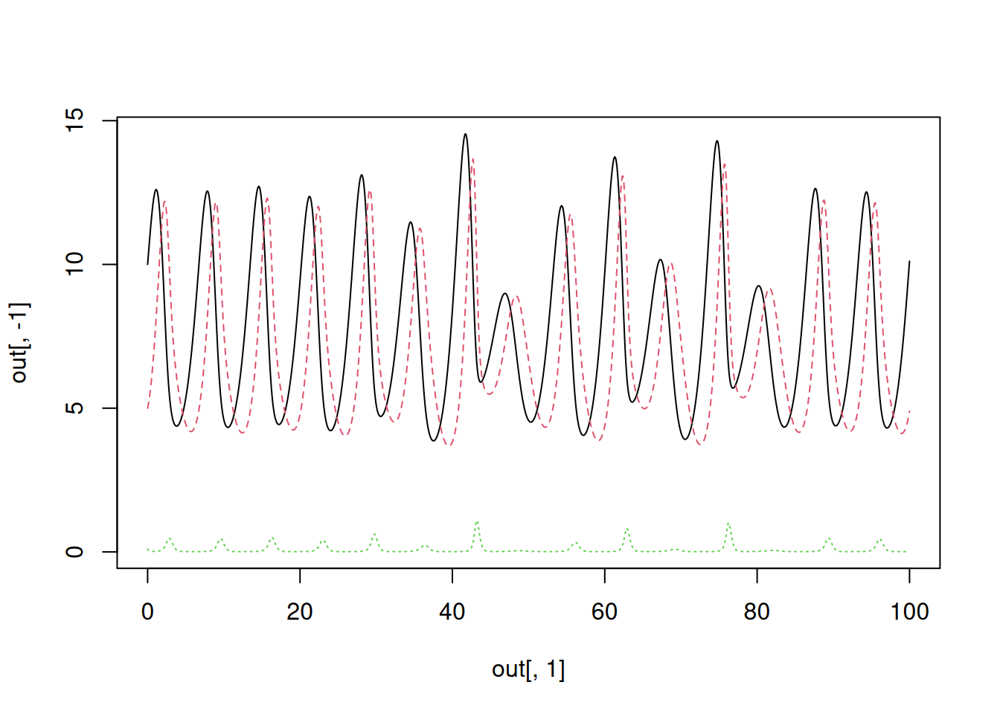
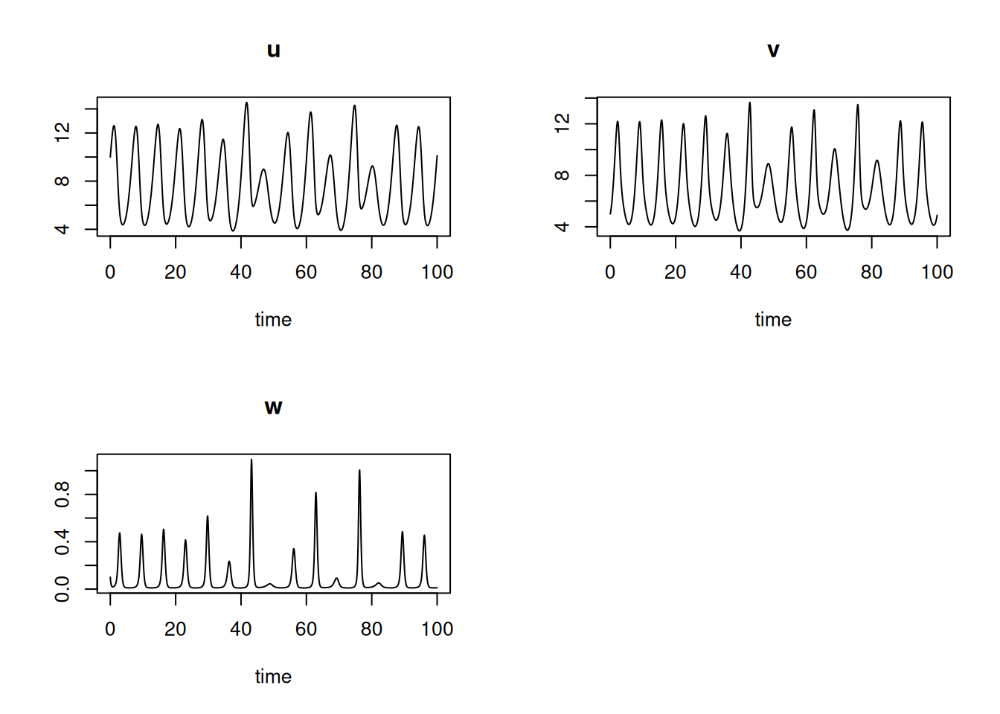
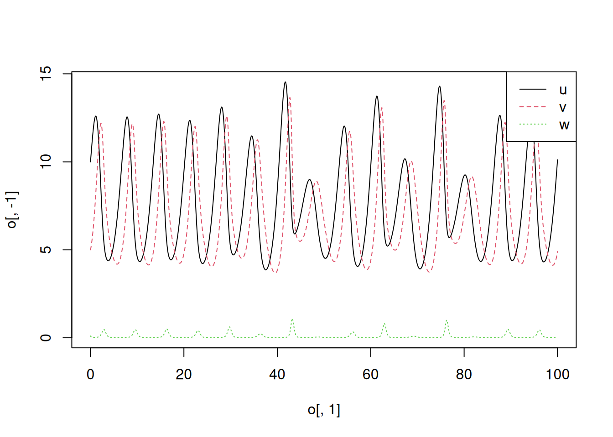
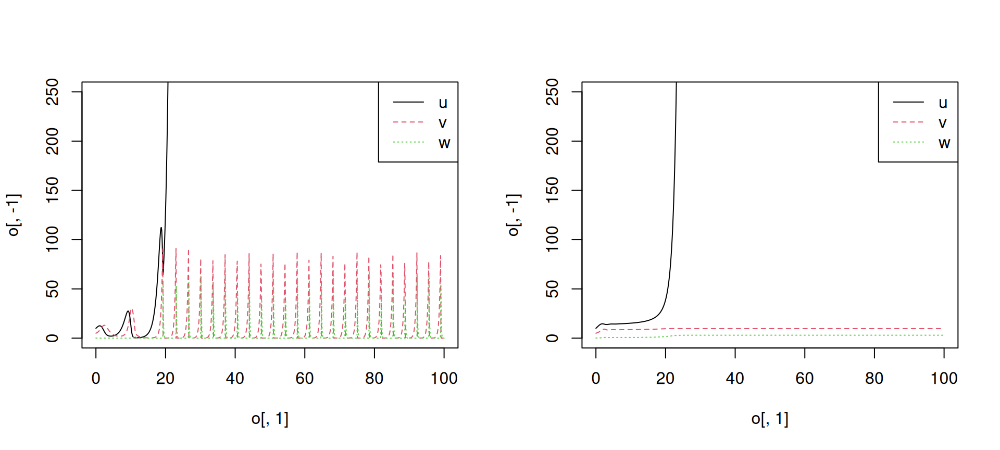
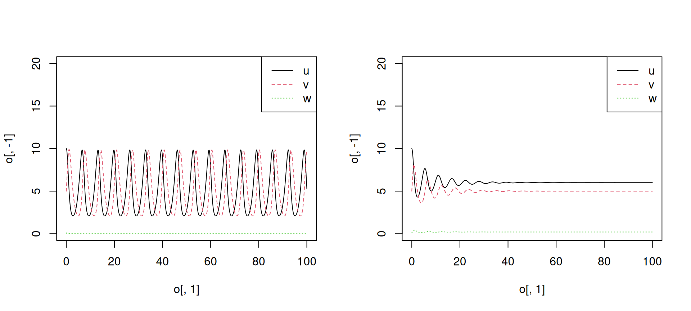
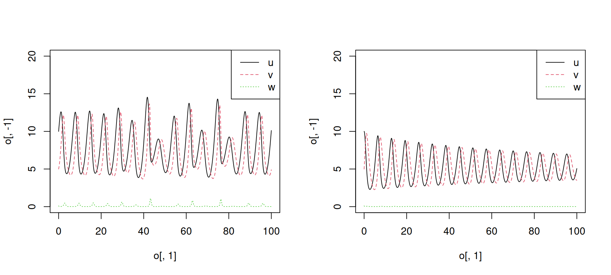
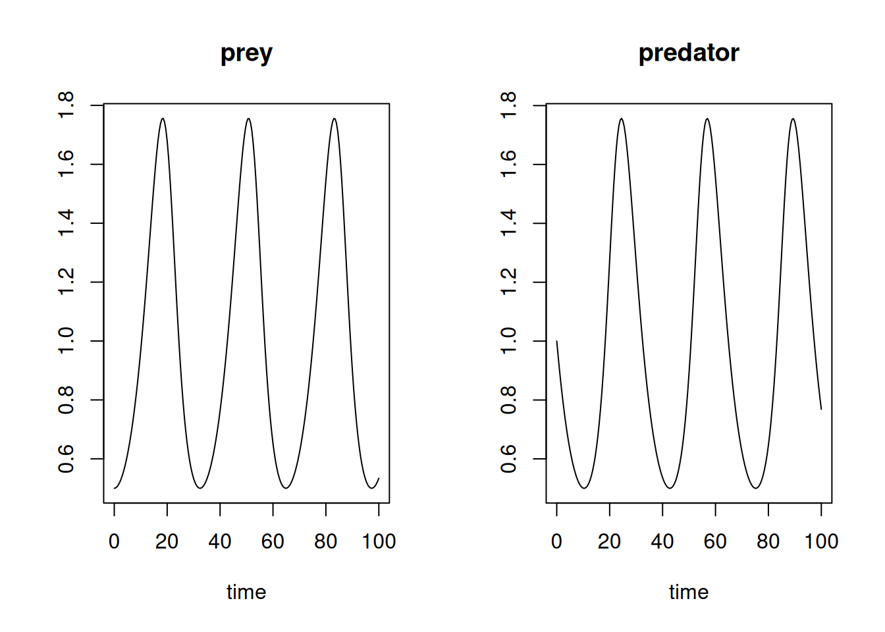
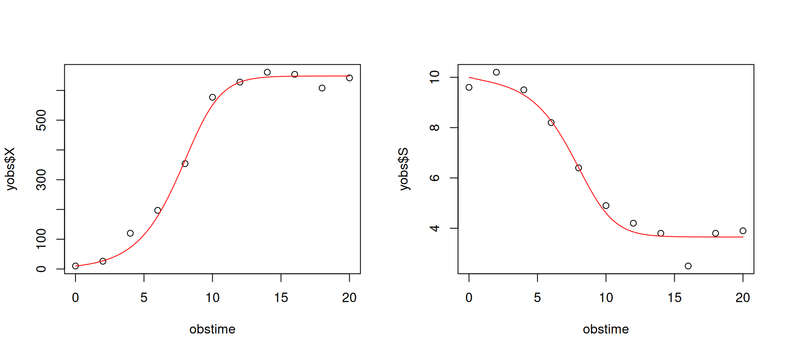
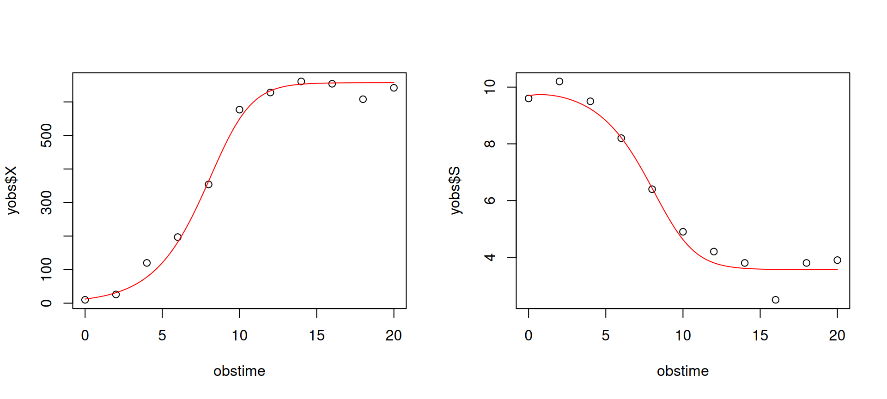

# 2. simecol-Howto: Tips, Tricks and Building Blocks

## 1 The Basics

### 1.1 Building `simecol` objects

The intention behind **simecol** is the construction of “all-in-one”
model objects. That is, everything that defines one particular model,
equations and data are stored together in one `simObj` (spoken:
sim-Object), and only some general algorithms (e.g., differential
equation solvers or interpolation routines) remain external, preferably
as package functions (e.g., function `lsoda` in the package **deSolve**
([Soetaert et al. 2010](#ref-deSolve_jss))) or as functions in the user
workspace.

This strategy has three main advantages:

1.  We can have several independent versions of one model in the
    computer memory at the same time. These instances may have different
    settings, parameters and data or even use different formulas, but
    they do not interfere with each other. Moreover, if all data and
    functions are *encapsulated* in their `simObj`ects, identifiers can
    be re-used and it is, for example, not necessary to keep track over
    a large number of variable names or to invent new identifiers for
    parameter sets of different scenarios.
2.  We can give `simObj`ects away, either in binary form or as source
    code objects. Everything essential to run such a model is included,
    not only the formula but also defaults for parameters and data. You,
    or your users, need only R, some packages and your model object. It
    is also possible to start model objects directly from the internet
    or, on the other hand, to distribute model collections as R
    packages.
3.  All `simObj`ects can be handled, simulated and modified with the
    same generic functions, e.g., `sim`, `plot` or `parms`. Our users
    can start playing with the models without the need to understand all
    the internals.

While it is, of course, preferable to have all parts of a model
encapsulated in one object, it is not mandatory to have the complete
working model object before starting to use **simecol**.

**simecol** models (in the following called `simObj`ects) can be built
step by step, starting with mixed applications composed of rudimentary
`simObj`ects and ordinary user space functions. When everything works,
you should encapsulate all the main parts of your model in the
`simObj`ect to get a clean object that does not interfere with others.

#### 1.1.1 An example

We start with the example given in the `simecol-introduction` ([Petzoldt
and Rinke 2007](#ref-Petzoldt2007)), an implementation of the UPCA model
of Blasius et al. ([1999](#ref-Blasius1999)), but we write it in the
usual **deSolve** style, i.e., without using **simecol**:

``` r

f <- function(x, y, k) { x * y / (1 + k * x) }  # Holling II

func <- function(time, y, parms) {
  with(as.list(c(parms, y)), {
    du <-  a * u           - alpha1 * f(u, v, k1)
    dv <- -b * v           + alpha1 * f(u, v, k1) +
                           - alpha2 * f(v, w, k2)
    dw <- -c * (w - wstar) + alpha2 * f(v, w, k2)
    list(c(du, dv, dw))
  })
}

times <- seq(0, 100, 0.1)
parms <- c(a = 1, b = 1, c = 10, alpha1 = 0.2, alpha2 = 1, k1 = 0.05, k2 = 0, wstar = 0.006)
y     <- c(u = 10, v = 5, w = 0.1)
```

The model is defined by 5 variables in the R user workspace, namely `f`,
`func`, `times`, `parms` and `y` (`init`). The implementation is similar
to the help page examples of package **deSolve** and we can solve it
exactly in the same manner:

``` r

library(deSolve)
out <- lsoda(y, times, func, parms)
matplot(out[, 1], out[, -1], type = "l")
```



Figure 1: Output of UPCA model, solved with `lsoda` from package
**deSolve**.

#### 1.1.2 Transition to `simecol`

If we compare this example with the **simecol** structure, we may see
that they are kind of similar. This obvious coincidence is quite
natural, because the notation of both **deSolve** and **simecol** is
based on the state-space notation of control theory[^1].

Due to this, only small restructuring and renaming is needed to form a
`simObj`:

``` r

library("simecol")
f <- function(x, y, k) { x * y / (1 + k * x) }  # Holling II

upca <- new("odeModel",
  main = function(time, y, parms) {
    with(as.list(c(parms, y)), {
      du <-  a * u           - alpha1 * f(u, v, k1)
      dv <- -b * v           + alpha1 * f(u, v, k1) +
                             - alpha2 * f(v, w, k2)
      dw <- -c * (w - wstar) + alpha2 * f(v, w, k2)
      list(c(du, dv, dw))
    })
  },
  times  = seq(0, 100, 0.1),
  parms  = c(a = 1, b = 1, c = 10, alpha1 = 0.2, alpha2 = 1,
             k1 = 0.05, k2 = 0, wstar = 0.006),
  init   = c(u = 10, v = 5, w = 0.1),
  solver = "lsoda"
)
```

We may notice that the assignment operators `<-` changed to a
declarative equal sign `=` for the slot definitions, that some of the
names (`y`, `func`) were changed to the pre-defined slot names of
**simecol** and that all the slot definitions are now comma-separated
arguments of the `new` function that creates the `upca` object. The
solver method `lsoda` is also given as a character string pointing to
the original `lsoda` function in package **deSolve**.

The new object can now be simulated very easily with the `sim` function
of **simecol** that returns the object with all original slots and one
additional slot `out` holding the output values. A generic `plot`
function is also available for basic plotting of the output:

``` r

upca <- sim(upca)
plot(upca)
```



It is now also possible to extract the results from `upca` with a
so-called accessor function `out`, and to use arbitrary, user-defined
plot functions:

``` r

plotupca <- function(obj, ...) {
  o <- out(obj)
  matplot(o[, 1], o[, -1], type = "l", ...)
  legend("topright", legend = c("u", "v", "w"), lty = 1:3, bg = "white", col = 1:3)
}
plotupca(upca)
```



Okay, that’s it, but note that function `f` is not yet part of the
`simecol` object, that’s why we call this here a “mixed implementation”.
This function `f` is rather simple here, but it would also be possible
to call functions of arbitrary complexity from `main`.

#### 1.1.3 Creating scenarios

After defining one `simecol` object (that we can call a parent object or
a **prototype**), we may create derived objects, simply by copying
(cloning) and modification. As an example, we create two scenarios with
different parameter sets:

``` r

sc1 <- sc2 <- upca
parms(sc1)["wstar"] <- 0
parms(sc2)["wstar"] <- 0.1
sc1 <- sim(sc1)
sc2 <- sim(sc2)
par(mfrow = c(1, 2))
plotupca(sc1, ylim = c(0, 250))
plotupca(sc2, ylim = c(0, 250))
```



Figure 2: Two scenarios of the UPCA model (left: `wstar = 0`, right:
`wstar = 0.1`; functional response `f` is Holling II).

If we simulate and plot these scenarios, we see an exponentially growing
$`u`$ in both cases, and cycles resp. an equilibrium state for $`v`$ and
$`w`$ for the scenarios respectively ([Figure 2](#fig-upca6)).

If we now also change the functional response function $`f`$ from
Holling II to Lotka-Volterra:

``` r

f <- function(x, y, k) { x * y }
```

both model scenarios, `sc1` and `sc2`, are affected by this new
definition:

``` r

sc1 <- sim(sc1)
sc2 <- sim(sc2)
par(mfrow = c(1, 2))
plotupca(sc1, ylim = c(0, 20))
plotupca(sc2, ylim = c(0, 20))
```



Figure 3: Two scenarios of the UPCA model (left: `wstar = 0`, right:
`wstar = 0.1`; functional response `f` is Lotka-Volterra).

Now, we get a stable cycle for $`u`$ and $`v`$ in scenario 1 and an
equilibrium for all state variables in scenario 2
([Figure 3](#fig-upca8)). You may also note that the new function `f`
has exactly the same parameters as above, including the, in the second
case obsolete, parameter `k`.

In the examples above, function `f` was an ordinary function in the user
workspace, but it is also possible to implement such functions (or
sub-models) directly as part of the model object. As one possibility,
one might consider defining local functions within `main`, but that
would have the disadvantage that such functions are not easily
accessible from outside.

To allow the latter, **simecol** has an optional slot `equations`, that
can hold a list of sub-models. Such an `equations` slot can be defined
either during object creation, or functions may be added afterwards. In
the following, we derive two new clones with default parameter settings
from the original `upca` object, and then assign one version (the
Holling II functional response) to scenario 1 and the other version
(simple multiplicative Lotka-Volterra functional response) to scenario 2
([Figure 4](#fig-upca9)):

``` r

sc1 <- sc2 <- upca
equations(sc1)$f <- function(x, y, k) { x * y / (1 + k * x) }
equations(sc2)$f <- function(x, y, k) { x * y }
sc1 <- sim(sc1)
sc2 <- sim(sc2)
par(mfrow = c(1, 2))
plotupca(sc1, ylim = c(0, 20))
plotupca(sc2, ylim = c(0, 20))
```



Figure 4: Two scenarios of the UPCA model (left: functional response `f`
is Holling II, right: functional response is Lotka-Volterra).

This method allows comparing models with different structures in the
same way as scenarios with different parameter values. In addition, it
is also possible to define model objects with different versions of
**built-in** sub-models, that can be alternatively enabled:

``` r

upca <- new("odeModel",
  main = function(time, y, parms) {
    with(as.list(c(parms, y)), {
      du <-  a * u           - alpha1 * f(u, v, k1)
      dv <- -b * v           + alpha1 * f(u, v, k1) +
                             - alpha2 * f(v, w, k2)
      dw <- -c * (w - wstar) + alpha2 * f(v, w, k2)
      list(c(du, dv, dw))
    })
  },
  equations = list(
    f1 = function(x, y, k) { x * y },               # Lotka-Volterra
    f2 = function(x, y, k) { x * y / (1 + k * x) }  # Holling II
  ),
  times  = seq(0, 100, 0.1),
  parms  = c(a = 1, b = 1, c = 10, alpha1 = 0.2, alpha2 = 1, k1 = 0.05, k2 = 0, wstar = 0.006),
  init   = c(u = 10, v = 5, w = 0.1),
  solver = "lsoda"
)

equations(upca)$f <- equations(upca)$f1
```

#### 1.1.4 Debugging

As stated before, all-in-one encapsulation of all functions and data in
`simObj`ects has many advantages, but there is also one disadvantage,
namely debugging. Debugging of S4 objects is sometimes cumbersome,
especially if slot functions (e.g., `main`, `equations`, `initfunc`)
come into play. These difficulties are not very important for
well-functioning ready-made model objects, but they appear as an
additional burden during model building, in particular if these models
are technically not as simple as in our example.

Fortunately, there are easy workarounds. One of them is implementing the
technically challenging parts in the user workspace first using the
above-mentioned mixed style. Then, after developing and debugging the
model and if everything works satisfactorily, integrating the parts into
the object is straightforward, given that you keep the general structure
in mind. In the example below, we implement the main model as a
workspace function `fmain`[^2] with the same interface (parameters and
return values) as above, which is then called by the `main` function of
the `simObj`:

``` r

f <- function(x, y, k) { x * y / (1 + k * x) }  # Holling II

fmain <- function(time, y, parms) {
  with(as.list(c(parms, y)), {
    du <-  a * u           - alpha1 * f(u, v, k1)
    dv <- -b * v           + alpha1 * f(u, v, k1) +
                           - alpha2 * f(v, w, k2)
    dw <- -c * (w - wstar) + alpha2 * f(v, w, k2)
    list(c(du, dv, dw))
  })
}

upca <- new("odeModel",
  main   = function(time, y, parms) fmain(time, y, parms),
  times  = seq(0, 100, 0.1),
  parms  = c(a = 1, b = 1, c = 10, alpha1 = 0.2, alpha2 = 1, k1 = 0.05, k2 = 0, wstar = 0.006),
  init   = c(u = 10, v = 5, w = 0.1),
  solver = "lsoda"
)
```

This function `fmain` as well as any other submodels like `f` can now be
debugged with the usual R tools, e.g., `debug`:

``` r

debug(fmain)
upca <- sim(upca)
```

Debugging can be stopped by `undebug(fmain)`. If everything works, you
can add the body of `fmain` to `upca` manually, and it is even possible
to do this in the formalized **simecol** way of object modification:

``` r

main(upca)        <- fmain   # assign workspace function to main slot
equations(upca)$f <- f       # assign workspace function to equations
rm(fmain, f)   # optional, for saving memory and avoiding confusion
str(upca)      # show the object
```

    Formal class 'odeModel' [package "simecol"] with 10 slots
      ..@ parms    : Named num [1:8] 1e+00 1e+00 1e+01 2e-01 1e+00 5e-02 0e+00 6e-03
      .. ..- attr(*, "names")= chr [1:8] "a" "b" "c" "alpha1" ...
      ..@ init     : Named num [1:3] 10 5 0.1
      .. ..- attr(*, "names")= chr [1:3] "u" "v" "w"
      ..@ observer : NULL
      ..@ main     :function (time, y, parms)
      ..@ equations:List of 1
      .. ..$ f:function (x, y, k)
      ..@ times    : num [1:1001] 0 0.1 0.2 0.3 0.4 0.5 0.6 0.7 0.8 0.9 ...
      ..@ inputs   : NULL
      ..@ solver   : chr "lsoda"
      ..@ out      : NULL
      ..@ initfunc : NULL

Now, we can delete `f` and `fmain` to have a clean workspace with only
the necessary objects.

### 1.2 Different ways to store `simObj`ects

One of the main advantages of **simecol** is that model objects can be
made persistent and that it is easy to distribute and share `simObj`ects
over the internet.

The most obvious and simple form is, of course, to use the original
source code of the objects, i.e., the function call to `new` with all
the slots which creates the S4 object (see
[Section 1.1.2](#sec-s4definition)), but there are also other
possibilities.

**simecol** objects can be saved in machine-readable form as S4 object
binaries with the `save` method of R, which stores the whole object with
all its equations, initial values, parameters, etc., and also the
simulation output if the model was simulated before saving:

``` r

save(upca, file = "upca.Rdata")  # persistent storage of the model object
load("upca.Rdata")               # load the model
```

Conversion of the S4 object to a list is another possibility, that
yields a representation that is readable by humans **and** by R:

``` r

l.upca <- as.list(upca)
```

This method allows getting an alternative text representation of the
`simObj`, that can be manipulated by code parsing programs or dumped to
the hard disk:

``` r

dput(l.upca, file = "upca_list.R")
```

and this is completely reversible via:

``` r

l.upca <- dget("upca_list.R")
upca <- as.simObj(l.upca)
```

Sometimes it may be useful to store `simObj`ects in an un-initialized
form, in particular if they are to be distributed in packages.

Let’s demonstrate this again with a simple Lotka-Volterra model. In the
first step, we define a function that returns a `simecol` object:

``` r

genLV <- function() {
  new("odeModel",
    main = function(time, init, parms) {
      x <- init
      p <- parms
      dx1 <-   p["k1"] * x[1] - p["k2"] * x[1] * x[2]
      dx2 <- - p["k3"] * x[2] + p["k2"] * x[1] * x[2]
      list(c(dx1, dx2))
    },
    parms  = c(k1 = 0.2, k2 = 0.2, k3 = 0.2),
    times  = c(from = 0, to = 100, by = 0.5),
    init   = c(prey = 0.5, predator = 1),
    solver = "lsoda"
  )
}
```

Now, the function contains the instruction for how R can create a new
instance of such a model. The `simecol` object is not created yet, but a
call to the creator function can bring it to life:

``` r

lv1 <- genLV()
plot(sim(lv1))
```



This style is used in package **simecolModels**[^3], a collection of
(mostly) published ecological models.

### 1.3 Methods to work with S4 objects

The S4 scheme includes several utility functions which can be used to
inspect objects and their methods. As an example, `showMethods` can be
used to list all different functions that are available for one method
(here `sim`), depending on the object types involved:

``` r

showMethods("sim")
```

    Function: sim (package simecol)
    obj="gridModel"
    obj="odeModel"
    obj="simObj"

Based on this information, it is now possible to inspect the source code
of the particular method, e.g., the `sim` function for differential
equation models (class `odeModel`):

``` r

getMethod("sim", "odeModel")
```

    Method Definition:

    function (obj, initialize = TRUE, ...)
    {
        if (initialize & !is.null(obj@initfunc))
            obj <- initialize(obj)
        times <- fromtoby(obj@times)
        func <- obj@main
        inputs <- obj@inputs
        equations <- obj@equations
        environment(func) <- environment()
        equations <- addtoenv(equations)
        if (is.null(inputs)) {
            out <- do.call(obj@solver, list(obj@init, times, func,
                obj@parms, ...))
        }
        else {
            out <- do.call(obj@solver, list(obj@init, times, func,
                obj@parms, inputs = obj@inputs, ...))
        }
        obj@out <- out
        invisible(obj)
    }
    <bytecode: 0x61bf12c31528>
    <environment: namespace:simecol>

    Signatures:
            obj
    target  "odeModel"
    defined "odeModel"

In addition to this, R has several other functions to inspect or
manipulate objects, e.g., `hasMethod`, `findMethod`, or `setMethod`;
please see the documentation of these functions for details.

------------------------------------------------------------------------

## 2 Fitting Parameters

The preferred method to obtain model parameters is direct measurement of
process rates. This can be done in controlled experiments or by taking
results from the literature. However, not all processes are accessible
by direct measurement. In such cases process parameters can be
identified indirectly by calibration from observed data.

### 2.1 Example model and data

In order to demonstrate parameter fitting we use a simple ODE model with
two coupled differential equations:

``` math
\begin{aligned} \frac{dX}{dt} &= \mu X - D X \\ \frac{dS}{dt} &= D (S_0 - S) - \frac{1}{Y} \mu X \end{aligned}
```

with Monod functional response:

``` math
\mu = v_m \frac{S}{k_m + S}
```

where:

- $`X`$: abundance or biomass concentration
- $`S`$: substrate concentration
- $`D`$: dilution rate
- $`Y`$: yield constant (i.e., conversion factor between $`S`$ and
  $`X`$)
- $`\mu`$: growth rate
- $`v_m`$: maximum growth rate
- $`k_m`$: half-saturation constant

### 2.2 Load the model and assign a solver

The chemostat model is one of the standard examples in package
**simecol**, that can be loaded like a data set.

In the following, instead of the default solver `lsoda`, an explicit
solver `adams` can be used, because the problem is not stiff. However,
package **deSolve** only contains dedicated functions for the most
common solvers like `lsoda` or `rk4`, while other solvers like `adams`
(for non-stiff) or `bdf` (for stiff systems) are specified by calling
`ode` with an appropriate `method` option.

``` r

data(chemostat)
solver(chemostat) # shows which solver we have
```

    [1] "lsoda"

``` r

## assign an alternative solver
solver(chemostat) <- function(y, times, func, parms, ...) {
  ode(y, times, func, parms, method = "adams", ...)
}
```

Now, we create two working copies `cs1` and `cs2` for further usage:

``` r

cs1 <- cs2 <- chemostat
```

Let’s also assume we have the following test data:

``` r

obstime <- seq(0, 20, 2)
yobs <- data.frame(
  X = c(10, 26, 120, 197, 354, 577, 628, 661, 654, 608, 642),
  S = c(9.6, 10.2, 9.5, 8.2, 6.4, 4.9, 4.2, 3.8, 2.5, 3.8, 3.9)
)
```

Note that in this example, `yobs` contains two columns (and only two)
with exactly the same column names as the state variables.

### 2.3 Parameter estimation in `simecol`

Package **simecol** has a basic function for fitting parameters of ODE
models (`fitOdeModel`) built in. This function is a wrapper that uses
existing optimization functions of R, currently `nlminb` with the
`"PORT"` algorithm, `newuoa` and `bobyqa` from package **minqa**
([Powell 2009](#ref-Powell2009); [Bates et al. 2024](#ref-minqa)) and
`optim` with `"Nelder-Mead"`, `"BFGS"`, `"CG"`, `"L-BFGS-B"` and
`"SANN"` (cf. [**Rcore2015?**](#ref-Rcore2015); [Nash
1990](#ref-Nash1990), and others). Among these, only `"PORT"`,
`"bobyqa"` and `"L-BFGS-B"` support constrained optimization natively,
whereas for the others `fitOdeModel` tries to emulate box constraints
(more or less successfully) using an arctan transformation (see
`p.constrain`).

In order to save computation time it is suggested to use an efficient
variable time step algorithm (e.g., `adams` or `bdf`, depending on the
system) and to set external time steps of the model to the time steps
contained in the observational data:

``` r

times(cs1) <- obstime
```

For the most basic call to the parameter fitting function we need only
the model object, the time steps and the observational data:

``` r

res <- fitOdeModel(cs1, obstime = obstime, yobs = yobs)
```

In this case, **all** parameters are fitted by least squares between
**all** state variables and their corresponding observations. The start
values for parameter estimation are taken from the `simObj`ect. Sum of
squares of the individual state variables is weighted by the inverse
standard deviation of the observations and the Nelder-Mead algorithm is
used by default.

Many options are available to control the parameter fitting, e.g., to
fit only a subset of parameters (`whichpar`), to control the amount of
information displayed (`debuglevel`, `trace`), weighting of state
variables (`sd.yobs`) or individual data points (`weights`), or the
algorithm used (`method`).

In the following, we fit only $`v_m`$, $`k_m`$ and $`Y`$ with the PORT
algorithm, which is in many cases faster than the other methods,
especially if the range of parameters is known (constrained
optimization, e.g., to avoid negative values for $`k_m`$). It is also a
good idea to assign reasonable start values to the `simObj`ect. For
interactive use it is recommended to set `trace = TRUE`.

``` r

whichpar <- c("vm", "km", "Y")
lower    <- c(vm = 0, km = 0, Y = 0)
upper    <- c(vm = 100, km = 500, Y = 200)
parms(cs1)[whichpar] <- c(vm = 5, km = 10, Y = 100)

res <- fitOdeModel(cs1, whichpar = whichpar,
  lower = lower, upper = upper,
  obstime = obstime, yobs = yobs, method = "PORT",
  control = list(trace = FALSE))
```

    relative convergence (4) 

The results are now stored in a list structure `res`, from which
parameters, objective (sum of squares) or information about convergence
can be extracted:

``` r

res
```

    An object of class "modelFit"
    Slot "par":
            vm         km          Y
      2.084100   4.805418 102.147774

    Slot "message":
    [1] "relative convergence (4)"

    Slot "value":
    [1] 0.3357664

    Slot "list":
    $par
            vm         km          Y
      2.084100   4.805418 102.147774

    $objective
    [1] 0.3357664

    $convergence
    [1] 0

    $iterations
    [1] 25

    $evaluations
    function gradient
          35       99

    $message
    [1] "relative convergence (4)"

    $value
    [1] 0.3357664

Future versions of **simecol** will probably contain specific functions
to extract this information in a more user-friendly style.

The success of parameter estimation can now be controlled numerically
and graphically. First we assign the new parameters to a copy of the
model object:

``` r

parms(cs2)[whichpar] <- res$par
```

We get $`r^2`$ for both state variables with:

``` r

times(cs2) <- obstime
ysim <- out(sim(cs2))
1 - var(ysim$X - yobs$X) / var(yobs$X)
```

    [1] 0.9929231

``` r

1 - var(ysim$S - yobs$S) / var(yobs$S)
```

    [1] 0.973923

Note that time steps in data and model must be the same. However, for
producing a smooth figure it is recommended to use a smaller time step.
We will need this figure also for further examples, so it makes sense to
define a function:

``` r

plotFit <- function() {
  times(cs2) <- c(from = 0, to = 20, by = 0.1)
  ysim <- out(sim(cs2))
  par(mfrow = c(1, 2))
  plot(obstime, yobs$X, ylim = range(yobs$X, ysim$X))
  lines(ysim$time, ysim$X, col = "red")
  plot(obstime, yobs$S, ylim = range(yobs$S, ysim$S))
  lines(ysim$time, ysim$S, col = "red")
}
plotFit()
```



Figure 5: Observed data and fitted model.

### 2.4 Estimation of initial values

In the example above, we assumed that the initial values were known and
in fact, we used the built-in initial values from the default example.
In many cases, however, initial values must be estimated from observed
data because they are either completely unknown or known with a certain
error.

In order to estimate initial values from data, we have to add them to
the list of parameters in a technical sense:

``` r

parms(cs1) <- c(parms(cs1), init(cs1))
parms(cs1)
```

       vm    km     Y     D    S0     X     S
      5.0  10.0 100.0   0.9  10.0  10.0  10.0 

The second step is to assign these parameters back to the vector of
initial values at the beginning of a new simulation, i.e., to initialize
the model object with new start values determined by the optimization
algorithm before simulation and calculation of sum of squares. For such
purposes, **simecol** objects have a special function slot `initfunc`
and the only thing we have to do is to assign an appropriate function
which copies the appropriate values from `parms` to `init`:

``` r

initfunc(cs1) <- function(obj) {
  init(obj) <- parms(obj)[c("X", "S")]
  obj
}
```

Note that `initfunc` gets an object as input which is then modified and
returned. Note also that number and order of initial values must be
consistent with `main`.

``` r

whichpar <- c("vm", "km", "X", "S")
lower    <- c(vm = 0, km = 0, X = 0, S = 0)
upper    <- c(vm = 100, km = 500, X = 100, S = 100)
parms(cs1)[whichpar] <- c(vm = 10, km = 10, X = 10, S = 10)

res <- fitOdeModel(cs1, whichpar = whichpar,
  lower = lower, upper = upper,
  obstime = obstime, yobs = yobs, method = "Nelder",
  control = list(trace = FALSE))
```

Assigning fitted parameters and a new simulation now results in
([Figure 6](#fig-fit2)):

``` r

initfunc(cs2) <- initfunc(cs1)
parms(cs2)[whichpar] <- res$par

plotFit()
```



Figure 6: Observed data and fitted model ($`k_m`$, $`v_m`$ and initial
values were estimated).

Note that the model object `cs2` should have a copy of the `initfunc`
too, otherwise it is necessary to assign the initial values manually.

### 2.5 Scaling and weighting

Appropriate scaling of **observational variables** is crucial. On one
hand, scaling is necessary because variables may be of different order
of magnitude or have different measurement units (comparing apples and
oranges), but on the other hand estimated parameters heavily depend on
this decision.

Weighting is related to scaling. It may be required to weight
**individual data points**, depending on their accuracy or the number of
measurements they rely on.

A third type of scaling is sometimes necessary for numerical reasons if
**parameters** have very different order of magnitude. Some algorithms
(e.g., PORT) try to do this automatically, but sometimes even for this
an optional scaling argument is required.

### 2.6 Scaling of variables

The default scaling method used in **simecol** is division by the
standard deviation of observational values (per variable, i.e., per
column), but sometimes it is necessary to provide user-specified
scaling. Depending on the question and kind of data, different
assumptions may be appropriate, for example mean, median, range, an
appropriate conversion constant or a kind of “expert judgement” that
helps to make state variables comparable.

The following example uses default scaling (standard deviations of
observations):

``` r

whichpar <- c("vm", "km")
parms(cs1)[whichpar] <- c(vm = 5, km = 2)

res <- fitOdeModel(cs1, whichpar = whichpar,
  obstime = obstime, yobs = yobs, method = "Nelder")
```

``` r

res$value
```

    [1] 0.3432354

``` r

res$par
```

          vm       km
    2.045580 4.561685 

and in the second example, we set scaling for both variables to one
(i.e., divide both variables by 1). This means that no scaling is
applied at all and the original dimensions remain:

``` r

res <- fitOdeModel(cs1, whichpar = whichpar,
  obstime = obstime, yobs = yobs, method = "Nelder",
  sd.yobs = c(1, 1))
```

``` r

res$value
```

    [1] 4984.078

``` r

res$par
```

          vm       km
    2.073279 4.645150 

It is obvious that the resulting sum of squares and also the estimated
parameters of these two approaches are different.

### 2.7 Weighting of observations

Weighting of observations (i.e., per row or per individual value) can be
useful in different circumstances, e.g., if measurements have different
precision, if variance is not constant over the range of observations
(violation of homoscedasticity) or if data points represent multiple
measurements.

Let’s assume that we want to downweight the last three values (`9:11`)
for any reason to one third; we simply define a data frame with the same
structure as the observational data (`yobs`) and assign appropriate
weights:

``` r

weights <- data.frame(X = rep(1, nrow(yobs)),
                      S = rep(1, nrow(yobs)))
weights[9:11, ] <- 1 / 3
res <- fitOdeModel(cs1, whichpar = whichpar,
  obstime = obstime, yobs = yobs, method = "Nelder",
  weights = weights)
```

``` r

res$value
```

    [1] 0.217263

``` r

res$par
```

          vm       km
    2.066341 4.689334 

### 2.8 Scaling of parameters

If the parameters to be fitted have very different orders of magnitude
(e.g., one is $`0.1`$ and another is $`10^7`$), then it is possible that
optimization fails due to numerical problems. One possibility to avoid
this is to reformulate the problem in such a way that the sizes of
parameters do not differ too much. Depending on the algorithm used, it
may also be possible to let the optimizer do this rescaling of
parameters, e.g., via argument `scale` for the PORT algorithm or with
`control = list(parscale = ...)` for the algorithms in `optim`. Please
consult the original help pages for details.

Normally, the PORT algorithm (in function `nlminb`) does automatic
rescaling, but if required, scaling by
$`\text{scale} = 1 / \text{par}_{\max}`$ may help:

``` r

res <- fitOdeModel(cs1, whichpar = whichpar,
  obstime = obstime, yobs = yobs, method = "PORT",
  scale = 1 / c(vm = 2, km = 5))
```

    relative convergence (4) 

``` r

res$value
```

    [1] 0.343234

``` r

res$par
```

          vm       km
    2.046093 4.564152 

### 2.9 Parameter estimation with `FME`

**FME** (Flexible Modeling Environment, [Soetaert and Petzoldt
2010](#ref-Soetaert2010)) is a package that contains functions to
perform complex applications of models consisting of differential
equations, especially fitting models to data, sensitivity analysis and
Markov chain Monte Carlo.

The essential principles of model fitting with **FME** are quite similar
to the above, including fine-tuning of the underlying optimization
algorithms. However, in contrast to `fitOdeModel`, **FME**’s `modFit` is
**much more powerful**. It allows using several additional optimizers
and gives more detailed output, especially standard errors and
covariances (correlations) of parameter estimates. Other advantages are
the flexible way to define own minimization criteria (cost functions),
the existence of summary functions to extract the outputs and the
availability of an advanced Markov chain Monte Carlo (MCMC) algorithm.

In the following we give a full example to demonstrate its use with the
same model and data as above. We use the chemostat model again, together
with the test data set. The user-defined cost function (`Cost`) contains
simulation and comparison between simulated and observed data (function
`modCost`) as the last statement in the function. Note that `modCost`
requires that both simulated and observed data contain a `time` column.
This is already available in `ysim` (returned by the solver), but we
have to add it also to `yobs`. As above, appropriate scaling (resp.
weighting) of variables is also an important point. Here, setting
`weight = "std"` does the same as the default `sd.yobs` in the former
example; other possibilities are described in the respective online help
pages.

``` r

library(FME)
library(simecol)
data(chemostat)

cs1 <- chemostat

obstime <- seq(0, 20, 2)
yobs <- data.frame(
  X = c(10, 26, 120, 197, 354, 577, 628, 661, 654, 608, 642),
  S = c(9.6, 10.2, 9.5, 8.2, 6.4, 4.9, 4.2, 3.8, 2.5, 3.8, 3.9)
)

Cost <- function(p, simObj, obstime, yobs) {
  whichpar <- names(p)
  parms(simObj)[whichpar] <- p
  times(simObj) <- obstime
  ysim <- out(sim(simObj))
  modCost(ysim, yobs, weight = "std")
}

yobs <- cbind(time = obstime, yobs)

Fit <- modFit(p = c(vm = 10, km = 10), f = Cost, simObj = cs1,
  obstime = obstime, yobs = yobs, method = "Nelder", control = list(trace = FALSE))
```

Setting `trace = TRUE` in interactive sessions helps to observe how
minimization proceeds. Moreover, it is of course also possible to use
other optimization algorithms or to constrain the parameters within
sensible ranges.

The output can now be extracted with appropriate methods:

``` r

summary(Fit)
```


    Parameters:
       Estimate Std. Error t value Pr(>|t|)
    vm  2.04569    0.06292   32.52  < 2e-16 ***
    km  4.56202    0.35542   12.84  4.1e-11 ***
    ---
    Signif. codes:  0 '***' 0.001 '**' 0.01 '*' 0.05 '.' 0.1 ' ' 1

    Residual standard error: 0.131 on 20 degrees of freedom

    Parameter correlation:
           vm     km
    vm 1.0000 0.9796
    km 0.9796 1.0000

``` r

deviance(Fit)
```

    [1] 0.3432358

``` r

coef(Fit)
```

          vm       km
    2.045692 4.562017 

You may also test the following, but we omit its output here to save
space:

``` r

residuals(Fit)
df.residual(Fit)
plot(Fit)
```

------------------------------------------------------------------------

## 3 Implementing Models in Compiled Languages

Compilation of model code can speed up simulations considerably and
there are several ways to call compiled code from R; so it is possible
to use functions written in C/C++ or Fortran in the ordinary way
described in the “Writing R Extensions” manual
([**Rexts2006?**](#ref-Rexts2006)). This can speed up computations, but
still a certain amount of communication overhead is needed because
control is given back to R in every simulation step.

In addition to this basic method, it is also possible to enable direct
communication between integration routines and the model code if both
are available in compiled languages and if the direct call of a compiled
model is supported by the integrator. All integrators of package
**deSolve** support this; see the **deSolve** documentation for details.

### 3.1 An Example in C

Now, let’s inspect an example. We first provide our model as described
in the **deSolve** vignette “Writing Code in Compiled Language”, here
again the Lotka-Volterra model:

``` c
/* file: clotka.c */
#include <R.h>

static double parms[3];

#define k1 parms[0]
#define k2 parms[1]
#define k3 parms[2]

/* It is possible to define global variables here */
static double aGlobalVar = 99.99;   // for testing only

/* initializer: same name as the dll (without extension) */
void clotka(void (* odeparms)(int *, double *)) {
  int N = 3;
  odeparms(&N, parms);
  Rprintf("model parameters succesfully initialized\n");
}

/* Derivatives */
void dlotka(int *neq, double *t, double *y,
  double *ydot, double *yout, int *ip) {

  // sanity check for the 2 'additional outputs'
  if (ip[0] < 2) error("nout should be at least 2");

  // derivatives
  ydot[0] = k1 * y[0]        - k2 * y[0] * y[1];
  ydot[1] = k2 * y[0] * y[1] - k3 * y[1];

  // the 2 additional outputs, here for demo purposes only
  yout[0] = aGlobalVar;
  yout[1] = ydot[0];
}
```

Using `#define` macros is a typical C trick to get readable names for
the parameters. This method is simple and efficient, and of course there
are more elaborate possibilities. One alternative is using dynamic
variables, another is doing callbacks to R.

The C code can now be compiled into a so-called shared library (on
Linux/macOS) or a DLL on Windows, that can be linked to R.

Compilation requires an installed C compiler (`gcc`) and some other
tools that are quite standard on Linux, and which are also available for
macOS or in the form of the **Rtools** collection[^4] for Windows.

If the tools are installed, compilation can be done directly from R
with:

``` r

system("R CMD SHLIB clotka.c")
```

The result, a shared library or DLL, can now be linked to the current R
session with `dyn.load`, which we show here for Windows, and which is
quite similar for Linux (see [**Rexts2006?**](#ref-Rexts2006), Writing R
Extensions for details). Note that you must set the working directory of
R to the path where the DLL resides or use the full path in the call to
`dyn.load`:

``` r

modeldll <- dyn.load("clotka.dll")
```

You can now call the derivatives `dlotka` of the model in the `main`
function of a **simecol** object.

### 3.2 Enabling Direct Communication Between Model and Solver

Another, more efficient way is to tell the solver (e.g., `lsoda`)
directly where to find the model in the DLL. This method circumvents the
communication overhead that occurs normally for every call from the
solver to the model DLL and is especially effective if small models are
called many times, e.g., in case of small time steps or if a model is
embedded in an optimization routine.

The trick consists of two parts:

1.  We write an almost empty `main` function that returns all the
    information that the ODE solver needs in the form of a list.
2.  Instead of putting a character reference to an existing solver
    function into the `solver` slot (e.g., `"lsoda"`), we write a
    user-defined interface to the solver and assign it to the `solver`
    slot as shown in the example.

Now, we can simulate our model as usual, while avoiding interpretation
and communication overhead of R during the integration:

``` r

clotka <- new("odeModel",
  ## note that 'main' does not contain any equations directly
  ## but returns information where these can be found
  ## 'nout' is the number of 'additional outputs'
  main = function(time, init, parms) {
    # a list with: dllname, func, [jacfunc], nout
    list(lib     = "clotka",
         func    = "dlotka",
         jacfunc = NULL,
         nout    = 2)
  },
  ## parms, times, init are provided as usual, enabling
  ## scenario control like for 'ordinary' simecol models
  parms  = c(k1 = 0.2, k2 = 0.2, k3 = 0.2),
  times  = c(from = 0, to = 100, by = 0.5),
  init   = c(prey = 0.5, predator = 1),
  ## special solver function that evaluates funclist
  ## and passes its contents directly to lsoda
  ## in the 'compiled function' mode
  solver = function(init, times, funclist, parms, ...) {
    f <- funclist()
    as.data.frame(lsoda(init, times, func = f$func,
      parms = parms, dllname = f$lib, jacfunc = f$jacfunc, nout = f$nout, ...)
    )
  }
)

clotka <- sim(clotka)

## the two graphics on top are the states
## the others are additional variables returned by the C code
## (for demonstration purposes here)
plot(clotka)

## Another simulation with more time steps
times(clotka)["to"] <- 1000
plot(sim(clotka))

## another simulation with intentionally reduced accuracy
## for testing
plot(sim(clotka, atol = 1))

dyn.unload(as.character(modeldll[2]))
```

You should note a considerable speed-up and you may ask if this is still
a **simecol** object, because the main parts are now in C, and you may
also ask why one should still write models in R if C or Fortran are so
much faster.

The answer is that speed of computation is not the only factor. What
counts is a good compromise between execution speed and programming
effort. Programming in scripting languages like R is much more
convenient than programming in compiled languages like C or Fortran.
Also, programming in compiled languages only pays off for the effort
required if models are quite large or if a large number of model runs is
performed. Even in such cases, a mixed R **and** C approach can be
efficient, because it is only necessary to implement the core
functionality of the model in C and most of the data manipulation and
scenario control can be done in R.

**simecol** follows exactly this philosophy. Implementing everything in
R is highly productive if speed is of minor importance, but you **may**
use C etc. whenever necessary, and even in that case you still have the
scenario management and data manipulation features of **simecol**.

------------------------------------------------------------------------

## 4 Troubleshooting

This chapter lists the reasons for the most common problems and error
messages. You can contribute to these sections by submitting bug
reports.

### 4.1 Error messages when creating `simObj`ects

**Message:**

``` text
Error in getClass(Class, where = topenv(parent.frame())) :
"odeModel" is not a defined class
```

*(Instead of `odeModel`, other class names are also possible.)*

- **Reasons:** The most common reason is forgetting to load the required
  **simecol** package. Another reason may be that you use a model class
  that is not contained in **simecol** (e.g., mistakenly `odemodel`
  instead of `odeModel`).
- **Solution:** Load the **simecol** package by
  [`library(simecol)`](https://github.com/tpetzoldt/simecol/). If this
  does not help, check spelling of the class name in `new`.

------------------------------------------------------------------------

**Message:**

``` text
Error in assign(nm, L[[nm]], p) : attempt to use
zero-length variable name
```

- **Solution:** Use `=` instead of `<-` for the lists (e.g., function
  definitions in `equations`) and function arguments.

------------------------------------------------------------------------

**Message:** `"Warning: a final empty element has been omitted"`

- **Solution:** Look for obsolete commas after the last element in lists
  (e.g., `parms`).

### 4.2 Error messages during model simulations

**Message:**

``` text
Error in lsoda(...... :
The number of derivatives returned by func() (3)
must equal the length of the initial conditions vector (2)
```

- **Reasons:** The number of state variables of ODE systems must be
  consistent between the input and the output of the derivative function
  that is called `func` in package **deSolve** from which this error
  message is printed. In **simecol** this function is called `main`. The
  other solvers of **deSolve** (e.g., `rk4`) or other compatible solver
  packages may issue similar messages.
- **Solution:** Check the number of parameters and also naming/length
  of:
  - the `init` slot of the model definition,
  - the usage of the second argument (commonly named `init`, `x` or `y`)
    in the `main` function,
  - the return value of `main`. The return value is a list whose first
    element must be a vector with the same length as `init`. Note that
    the order of `init` and the return value must also be identical.

------------------------------------------------------------------------

## 5 References

Bates, Douglas, Katharine M. Mullen, John C. Nash, and Ravi Varadhan.
2024. *Minqa: Derivative-Free Optimization Algorithms by Quadratic
Approximation*. <https://doi.org/10.32614/CRAN.package.minqa>.

Blasius, Bernd, Amit Huppert, and Lewi Stone. 1999. “Complex Dynamics
and Phase Synchronization in Spatially Extended Ecological Systems.”
*Nature* 399: 354–59. <https://doi.org/10.1038/20676>.

Nash, John C. 1990. *Compact Numerical Methods for Computers: Linear
Algebra and Function Minimisation*. CRC Press.

Petzoldt, Thomas, and Karsten Rinke. 2007. “: An Object-Oriented
Framework for Ecological Modeling in .” *Journal of Statistical
Software* 22 (9): 1–31. <https://doi.org/10.18637/jss.v022.i09>.

Powell, M. J. D. 2009. *The BOBYQA Algorithm for Bound Constrained
Optimization Without Derivatives (Technical Report No. DAMTP
2009/NA06)*. Cambridge: University of Cambridge, Department of Applied
Mathematics and Theoretical Physics, Centre for Mathematical Sciences.

Soetaert, Karline, and Thomas Petzoldt. 2010. “Inverse Modelling,
Sensitivity and Monte Carlo Analysis in Using Package .” *Journal of
Statistical Software* 33 (3): 1–28.
<https://doi.org/10.18637/jss.v033.i03>.

Soetaert, Karline, Thomas Petzoldt, and R. Woodrow Setzer. 2010.
“Solving Differential Equations in : Package .” *Journal of Statistical
Software* 33 (9): 1–25.
[https://doi.org/10.18637/jss.v033.i09](https://doi.org/10.18637/jss.v033.i09%20)
.

[^1]: See <https://en.wikipedia.org/wiki/State_space_(controls)>, last
    access 2018-05-07.

[^2]: Note that this function must never be named `"func"`, for some
    rather esoteric internal reasons which we shall not discuss further
    here.

[^3]: **simecolModels** can be downloaded from the R-Forge server,
    <https://simecol.r-forge.r-project.org/>.

[^4]: <https://cran.r-project.org/bin/windows/Rtools/>
